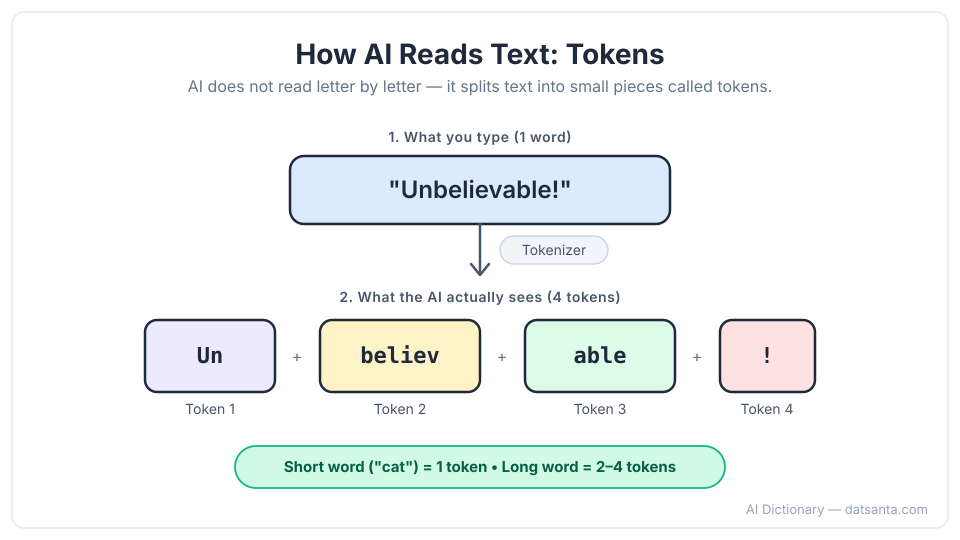

# Token

A **token** is the smallest chunk of text an AI reads or writes. It can be a full word, part of a longer word, or even a single punctuation mark.

## Everyday example

Think of tokens like Lego bricks of text. A short word such as `"cat"` is 1 brick, while a longer word such as `"Unbelievable!"` gets snapped into 4 smaller bricks: `Un` + `believ` + `able` + `!`.

AI tools measure length and pricing in tokens — much like a taxi meter counts kilometres instead of individual footsteps. In English, 100 tokens is roughly 75 words.

## Don't confuse with

- **Word:** One word can be split into multiple tokens, especially long words, numbers, or non-English text.
- **Character (letter):** A token is usually longer than a single letter, though punctuation marks like `!` or `?` often count as 1 token on their own.

## Related terms

- [LLM](llm.md)
- [Context window](context-window.md)
- [Prompt](prompt.md)
