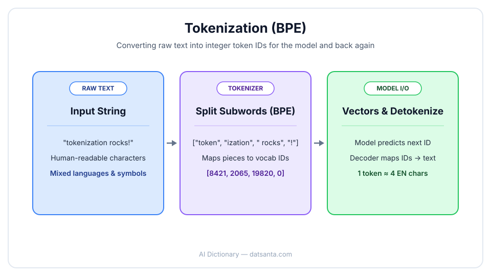

# Tokenization

**Tokenization** is the step that splits raw text into small integer IDs (called tokens) before a model can read it, and turns output token IDs back into readable text.

## Everyday example

Think of a kitchen ticket printer turning a waiter's full sentence ("extra hot oat latte, no sugar") into compact shorthand codes (`HOT-OAT-LAT-0SUG`) that the barista's machine processes fast. Modern LLMs use subword tokenizers like BPE (Byte Pair Encoding): common words stay whole (`"hello"` = 1 token), while rare or non-English words split into smaller pieces (`"tokenization"` = 2 tokens).

## Don't confuse with

- **[Embeddings](embeddings.md):** Tokenization assigns each chunk of text a lookup ID; embeddings turn those IDs into rich meaning vectors inside the neural network.

## Related terms

- [Token](token.md)
- [Token Counting](token-counting.md)
- [Context Window](context-window.md)
