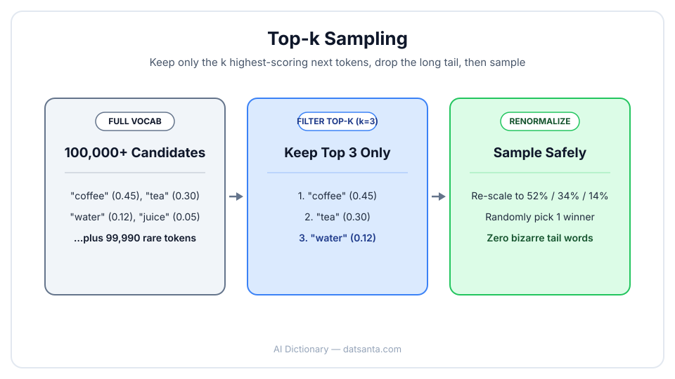

# Top-k Sampling

**Top-k sampling** is a decoding rule that restricts the model to choosing its next token only from the `k` highest-probability candidates, cutting off the long tail of weird or unlikely words.

## Everyday example

Imagine picking a lunch spot from a city of 5,000 restaurants by rolling a die. With `top-k = 5`, you only put the top 5 highest-rated places in the hat so you never accidentally end up at a shady gas station hotdog stand. Setting `k = 1` behaves like greedy decoding (always picking the single best option), while `k = 50` keeps variety alive without letting nonsense words slip in.

## Don't confuse with

- **[Top-p Sampling](top-p-sampling.md):** Top-k always keeps a fixed count of `k` candidates; top-p keeps however many candidates are needed to reach a cumulative probability threshold (like 90%).

## Related terms

- [Top-p Sampling](top-p-sampling.md)
- [Temperature](temperature.md)
- [Softmax](softmax.md)
