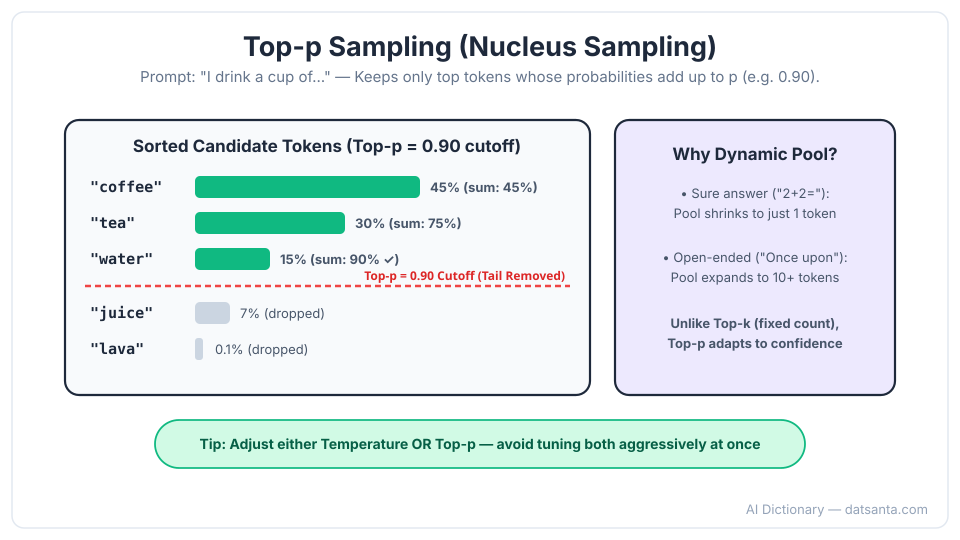

# Top-p Sampling

**Top-p sampling** (nucleus sampling) picks the next [token](token.md) from the smallest group of top candidates whose combined probabilities reach threshold `p` (for example, `0.90`), cutting off the absurd long tail.

## Everyday example

Suppose you ask *"I drank a cup of..."* and the model ranks `"coffee"` (45%), `"tea"` (30%), `"water"` (15%), `"juice"` (7%), and thousands of weird words like `"lava"` (0.01%).

With `top_p = 0.90`, the model sums `45% + 30% + 15% = 90%` and stops right there. Only those three sensible choices enter the lottery; `"lava"` is thrown out completely. If the model is 99% sure of one word, the pool shrinks automatically to 1.

## Don't confuse with

- **Top-k sampling:** Top-k always keeps a fixed number of candidates (say, top 50), even when only 2 words make sense; top-p adapts dynamically to model confidence.
- **[Temperature](temperature.md):** Temperature flattens or sharpens probabilities; most API providers recommend tuning *either* temperature or top-p, not both at once.

## Related terms

- [Temperature](temperature.md)
- [Token](token.md)
- [Inference](inference.md)
