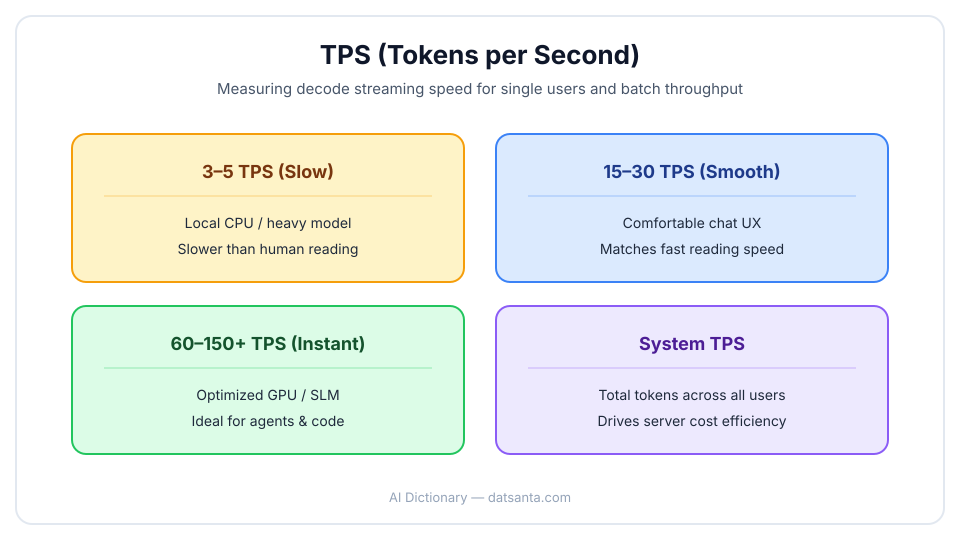

# TPS (Tokens per Second)

**TPS (Tokens per Second)** measures how fast an LLM generates output tokens during the decode phase—determining whether streamed text appears faster than a human can read or crawls word by word.

## Everyday example

Once a friend starts answering your question, TPS is their speaking speed in words per second. Humans read comfortably at around 5–10 tokens per second, so an API delivering 60+ TPS feels instantaneous for chat, while a local model running at 3 TPS on CPU feels noticeably sluggish. For batch pipelines, higher aggregate TPS across concurrent users directly lowers server cost.

## Don't confuse with

- **[TTFT (Time to First Token)](ttft.md):** TTFT is the startup delay before the first token arrives; TPS is the steady streaming speed afterward.

## Related terms

- [TTFT](ttft.md)
- [Latency vs. Throughput](latency-vs-throughput.md)
- [Inference](inference.md)
