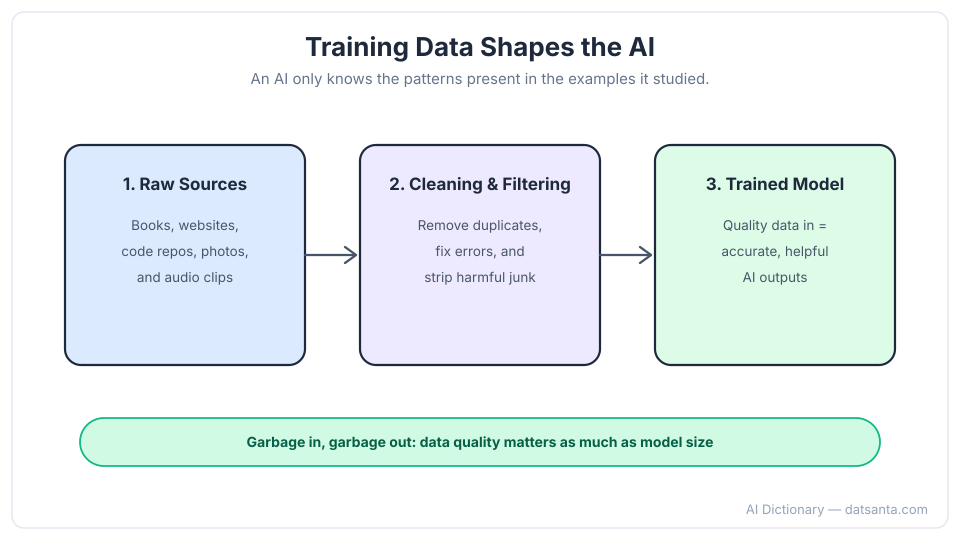

# Training Data

**Training data** is the huge collection of examples — books, websites, photos, code, or audio clips — that an AI studies during training so it can learn patterns and skills.

## Everyday example

If you learn to cook exclusively from Italian cookbooks, you will make great pasta — but struggle when someone asks for pho.

An AI is shaped the same way by its training data. Clean, diverse examples produce a helpful, accurate model. Outdated, sloppy, or biased training data leads directly to mistakes and [AI bias](ai-bias.md) ("garbage in, garbage out").

## Don't confuse with

- **[Prompt](prompt.md):** Your prompt is what you type at chat time; training data is what the AI studied months earlier before it was released.
- **[Dataset](dataset.md):** A dataset is any organized collection of data (for training, testing, or analysis); training data is specifically the portion used to teach the model.

## Related terms

- [Dataset](dataset.md)
- [Machine Learning](machine-learning.md)
- [AI Bias](ai-bias.md)
- [Knowledge Cutoff](knowledge-cutoff.md)
