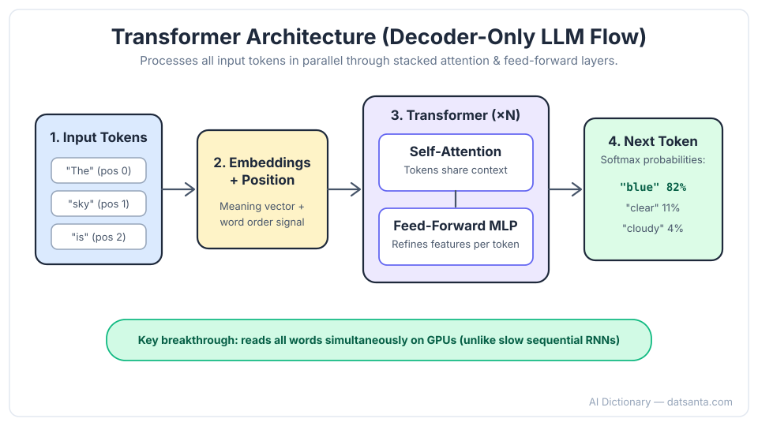

# Transformer

The **Transformer** is the neural network architecture behind modern [LLMs](llm.md). Its breakthrough is reading all input [tokens](token.md) in parallel and using [attention](attention-mechanism.md) layers to model relationships across the entire sequence at once.

## Everyday example

Older text models (RNNs) read like someone peering through a tiny keyhole, sliding across a page one word at a time — slow to train and prone to forgetting the start of a long paragraph.

A Transformer spreads the entire page flat on a table under bright light. Every word connects directly to every other word simultaneously across stacked attention and feed-forward blocks, letting GPUs train on massive datasets in parallel.

## Don't confuse with

- **RNN / LSTM:** Older sequential architectures that process word-by-word and struggle with long-range context; Transformers replaced them for language tasks.
- **[LLM](llm.md):** An LLM is the trained product (weights + data); Transformer is the underlying blueprint used to build it.

## Related terms

- [Attention Mechanism](attention-mechanism.md)
- [LLM](llm.md)
- [Embeddings](embeddings.md)
- [Inference](inference.md)
