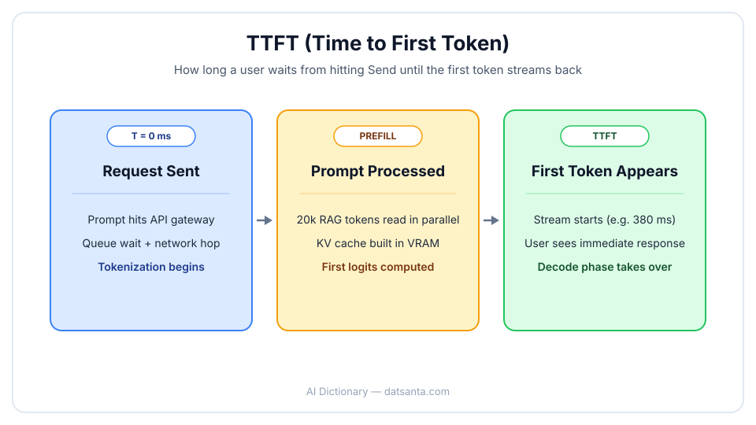

# TTFT (Time to First Token)

**TTFT (Time to First Token)** is how long a user waits after sending a prompt before the very first token of the AI's reply appears on screen.

## Everyday example

When you call a restaurant for takeout, TTFT is how many seconds pass before someone picks up the phone and says "Hello"—even if reading back your full order takes another 20 seconds. In chat apps using [streaming](streaming.md), a low TTFT (under 500 ms) makes the app feel snappy and alive, whereas a 6-second TTFT from a massive RAG prompt makes users think the app froze.

## Don't confuse with

- **[TPS (Tokens per Second)](tps.md):** TTFT measures the initial wait before output starts; TPS measures how fast words stream once generation begins.

## Related terms

- [Prefill and Decode](prefill-and-decode.md)
- [Streaming (SSE)](streaming.md)
- [Latency vs. Throughput](latency-vs-throughput.md)
