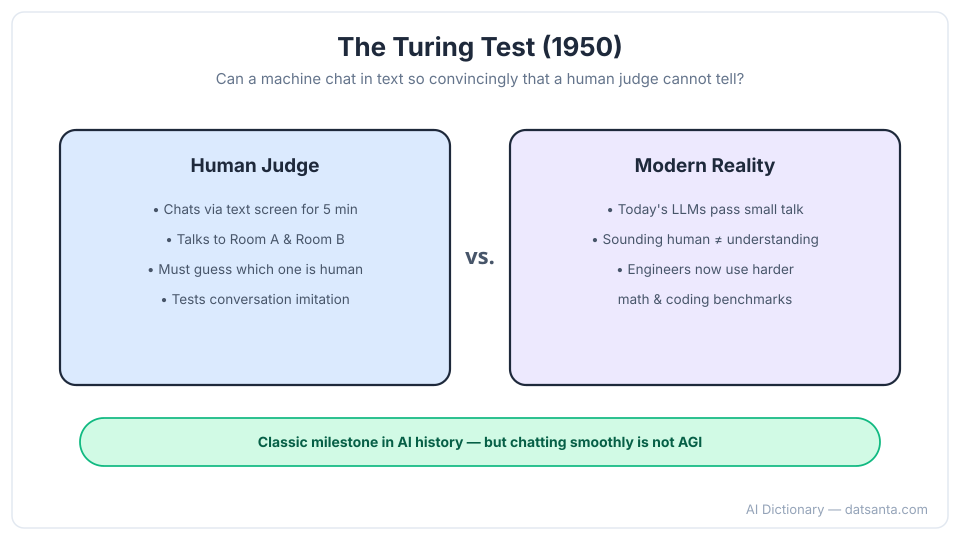

# Turing Test

The **Turing Test**, proposed by computer scientist Alan Turing in 1950, checks whether a machine can hold a text conversation so convincing that a human judge cannot reliably tell it apart from a real person.

## Everyday example

Imagine chatting through a screen with two hidden partners in separate rooms — one is a human friend, and the other is an AI [chatbot](chatbot.md). After five minutes of open conversation, if you guess wrong more often than right, the AI passes the test.

Modern [LLMs](llm.md) often sound remarkably human in casual chat, showing how far language AI has come — yet sounding human still does not equal true understanding or [AGI](agi.md).

## Don't confuse with

- **A test for [AGI](agi.md):** Passing a chat imitation test only proves strong language mimicry, not that the AI can reason reliably across every real-world job.
- **A modern [benchmark](benchmark.md):** Today's engineers prefer concrete math, coding, and accuracy benchmarks over whether an AI can fool someone in small talk.

## Related terms

- [AI](ai.md)
- [Chatbot](chatbot.md)
- [AGI](agi.md)
- [Benchmark](benchmark.md)
