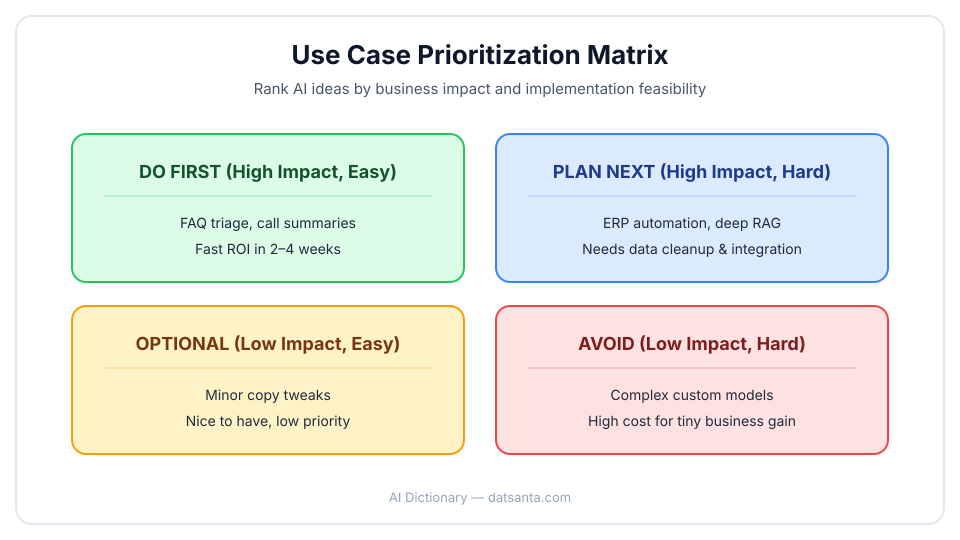

# Use-Case Prioritization

**Use-case prioritization** is ranking potential AI projects by business impact versus implementation effort so your company tackles quick, high-value wins first instead of chasing flashy, risky moonshots.

## Everyday example

Suppose a team lists 15 AI ideas. Rebuilding the entire ERP system with custom AI takes 12 months and high risk. Meanwhile, auto-summarizing daily sales calls into the CRM takes 2 weeks and saves 200 hours a month.

Plotting ideas on a 2×2 **Impact vs. Effort** grid makes the choice obvious: launch the "High Impact, Low Effort" quick wins first to fund and prove value for bigger bets later.

## Don't confuse with

- **Brainstorming:** Listing 20 exciting AI ideas is brainstorming; prioritization forces you to pick the top 1–2 and say "not yet" to the rest.
- **[AI ROI](ai-roi.md):** Prioritization happens *before* starting to pick the best candidates; ROI measures actual financial return *after* deployment.

## Related terms

- [AI Strategy](ai-strategy.md)
- [AI ROI](ai-roi.md)
- [Proof of Concept (POC)](proof-of-concept.md)
- [Bottleneck Analysis](bottleneck-analysis.md)
