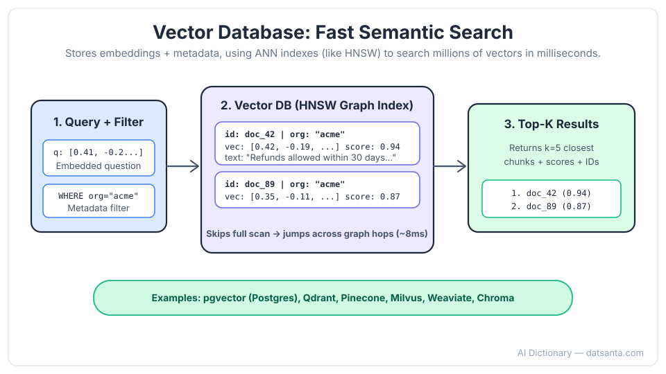

# Vector Database

A **vector database** stores [embeddings](embeddings.md) alongside text and metadata, using specialized indexes (such as `HNSW`) to find the closest semantic matches across millions of records in milliseconds.

## Everyday example

Imagine a library where books are arranged on 3D shelves by topic rather than alphabetically by title. Instead of walking past every single book (a slow brute-force scan), an `HNSW` graph index works like express elevators jumping straight to the right neighborhood.

When your [RAG](rag.md) app searches `"refund policy"`, the vector database filters `WHERE org = "acme"` and returns the top-5 closest chunks in ~8ms.

## Don't confuse with

- **Traditional SQL `LIKE` search:** SQL checks exact characters (`%refund%`), missing `"money-back guarantee"`; vector databases match conceptual similarity using [cosine similarity](cosine-similarity.md).
- **[Hybrid search](hybrid-search.md):** Pure vector databases can miss exact product IDs or error codes, which is why production stacks pair them with keyword search (`BM25`).

## Related terms

- [Embeddings](embeddings.md)
- [Cosine Similarity](cosine-similarity.md)
- [RAG](rag.md)
- [Hybrid Search](hybrid-search.md)
