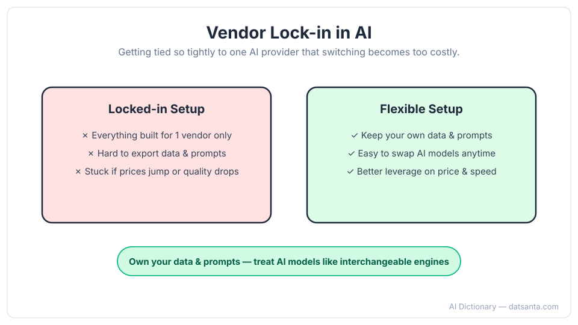

# Vendor Lock-in

**Vendor lock-in** happens when a company ties its data, workflows, and team habits so tightly to one AI provider that switching to a better or cheaper alternative becomes too expensive or painful.

## Everyday example

Think of buying a coffee machine that only works with one brand's patented capsules. The machine seems cheap at first, but once your office depends on it, you are stuck paying whatever price the brand sets for capsules.

In AI, if you store all company knowledge inside one closed vendor tool with no clean export, you cannot easily move when a competitor offers half the price or twice the accuracy.

## Don't confuse with

- **[Build vs. Buy](build-vs-buy.md):** Buying a ready-made tool is often smart; lock-in only becomes a problem when you cannot export your data, prompts, or workflows later.
- **[Fine-tuning](fine-tuning.md):** Fine-tuned models on one vendor's platform usually cannot be moved directly to another provider, unlike portable documents used in [RAG](rag.md).

## Related terms

- [Build vs. Buy](build-vs-buy.md)
- [RAG](rag.md)
- [AI ROI](ai-roi.md)
