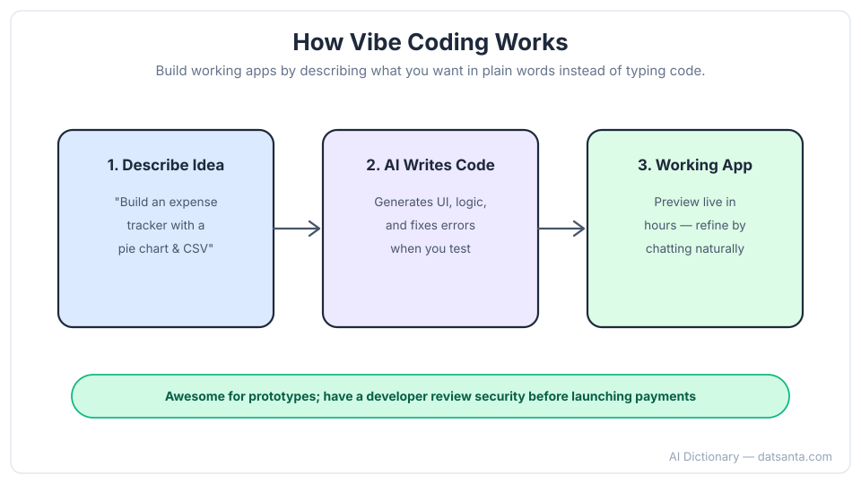

# Vibe Coding

**Vibe coding** is building working websites, scripts, or small apps by describing what you want to an AI in plain language and letting it write and fix the code — rather than typing code line by line yourself.

## Everyday example

Think of directing an interior designer instead of laying bricks yourself. You type *"Make a clean expense tracker with a pie chart and CSV export,"* test the preview, and say *"Make the buttons bigger and fix the total bug"* until it feels right.

Vibe coding lets beginners, designers, and founders build prototypes in hours. For serious production apps handling payments or user data, a developer still needs to review security and structure.

## Don't confuse with

- **Software engineering:** Professional engineering covers security, scaling, testing, and long-term maintenance; vibe coding focuses on speed and rapid prototyping.
- **No-code builders:** Drag-and-drop tools snap prebuilt blocks together; vibe coding generates real custom source code via [LLMs](llm.md).

## Related terms

- [Copilot](copilot.md)
- [Prompt Engineering](prompt-engineering.md)
- [AI Agent](ai-agent.md)
- [Sandbox](sandbox.md)
