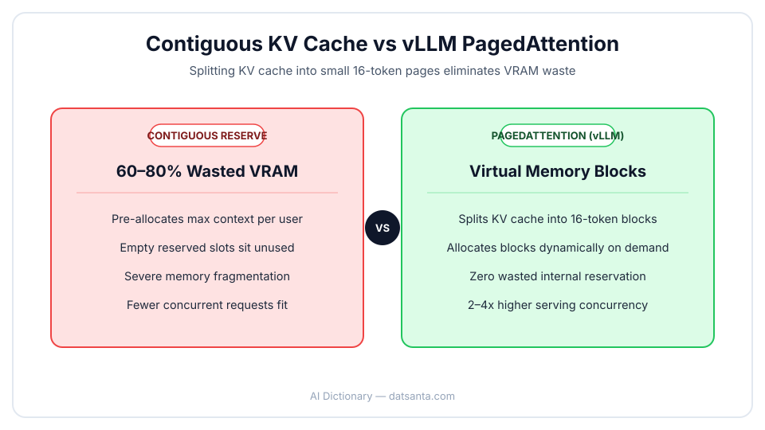

# vLLM (PagedAttention)

**vLLM** is a high-throughput open-source LLM inference engine famous for **PagedAttention**, which manages [KV cache](kv-cache.md) memory in small non-contiguous blocks—just like virtual memory pages in an operating system.

## Everyday example

Traditional serving engines reserve one huge contiguous parking lane for every incoming request's maximum context length, wasting 60–80% of [VRAM](vram.md) on empty reserved slots. vLLM splits GPU memory into small 16-token blocks and hands them out on demand anywhere space is free—eliminating fragmentation and serving far more concurrent users on the exact same GPU.

## Don't confuse with

- **[Ollama](ollama.md):** Ollama wraps llama.cpp for easy single-user local runs on laptops; vLLM is a production GPU serving engine built for high concurrency and [continuous batching](continuous-batching.md).

## Related terms

- [KV Cache](kv-cache.md)
- [Continuous Batching](continuous-batching.md)
- [VRAM](vram.md)
