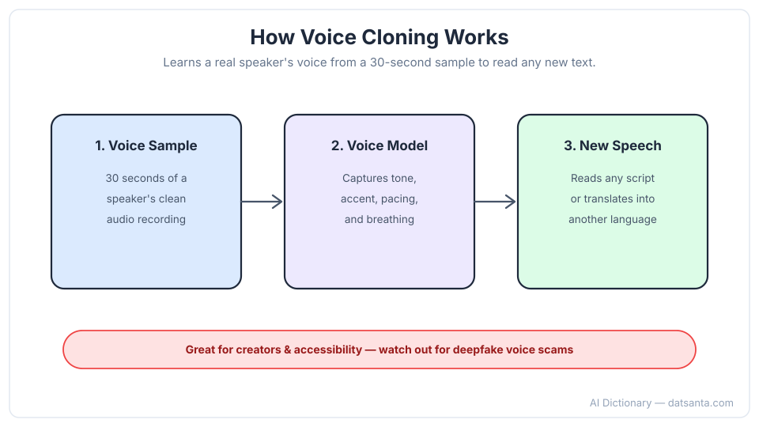

# Voice Cloning

**Voice cloning** is an AI technique that studies a short audio sample of a real person's voice and learns to speak any new written text in that exact tone, accent, and rhythm.

## Everyday example

Think of a voice actor who records 30 seconds of sample audio once, then lets an app read a whole 10-hour audiobook or translate their YouTube video into Spanish while keeping their own recognizable voice.

While helpful for creators, podcasts, and people losing their speech due to illness, voice cloning is also abused by scammers to impersonate family members or bosses in [deepfake](deepfake.md) phone calls.

## Don't confuse with

- **Standard [text-to-speech](text-to-speech.md):** Standard TTS uses generic built-in studio voices; voice cloning specifically copies a *particular* real person's voice.
- **Voice modulation:** Simple pitch-shifting filters alter your live voice mechanically; AI voice cloning generates brand-new speech from text.

## Related terms

- [Text-to-Speech](text-to-speech.md)
- [Deepfake](deepfake.md)
- [AI Watermark](ai-watermark.md)
- [Responsible AI](responsible-ai.md)
