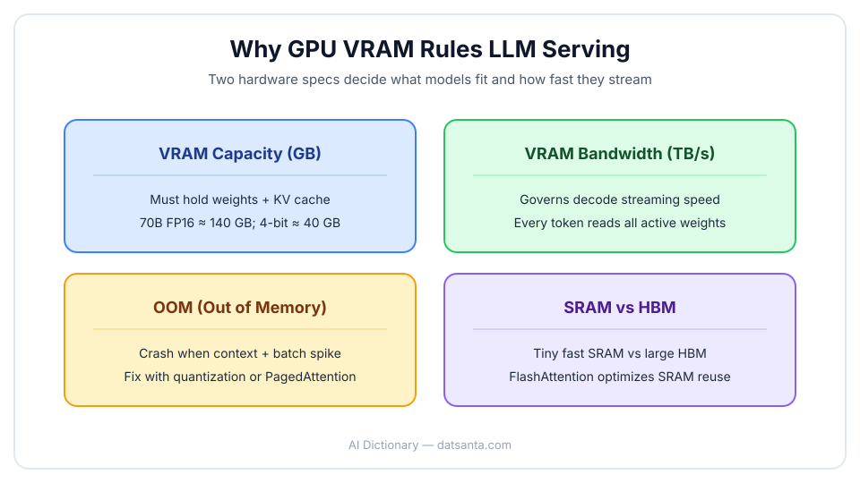

# VRAM (Video RAM)

**VRAM (Video RAM)** is the ultra-fast dedicated memory soldered right next to a GPU's compute cores—holding model weights, the [KV cache](kv-cache.md), and activations during training or inference.

## Everyday example

System RAM on your motherboard is like a big warehouse down the street, while VRAM is the high-speed workbench right in front of the craftsman. For LLMs, two numbers matter: **VRAM capacity** (in GB, deciding whether a 70B model even loads without crashing with Out-of-Memory) and **VRAM bandwidth** (in TB/s, deciding how fast decode streams tokens per second).

## Don't confuse with

- **[Token](token.md):** Tokens are the units of text a model reads and writes; VRAM is the physical GPU memory hardware storing the model and its runtime KV cache.

## Related terms

- [Quantization](quantization.md)
- [KV Cache](kv-cache.md)
- [Tensor Parallelism](tensor-parallelism.md)
