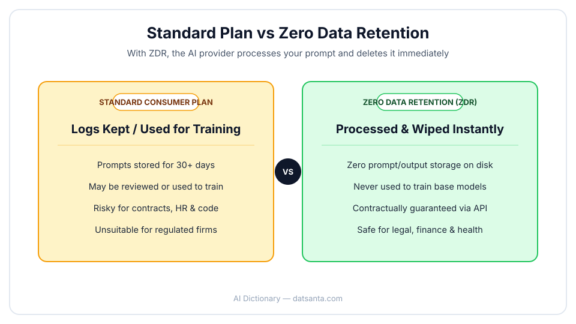

# Zero Data Retention

**Zero data retention (ZDR)** is a contractual and technical guarantee from an AI provider that your prompts, uploaded files, and AI replies are deleted immediately after processing—never stored or used to train future models.

## Everyday example

Using a public AI tool without zero data retention is like taking confidential contracts to a copy shop that keeps spare copies on its shelf to practice layout design. With ZDR enabled on an enterprise API, the provider processes your request in memory, sends back the answer, and shreds the temporary trace right away—critical for legal, medical, and finance teams.

## Don't confuse with

- **[Data Residency](data-residency.md):** Data residency keeps your data inside a chosen country; zero data retention ensures the AI vendor does not keep your prompts at all.

## Related terms

- [PII](pii.md)
- [IP Risk](ip-risk.md)
- [Enterprise Agreement](enterprise-agreement.md)
