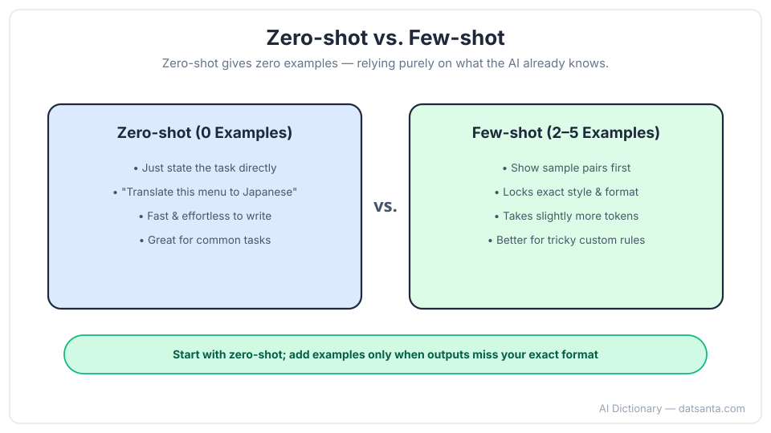

# Zero-shot

**Zero-shot** means asking an AI to perform a task straight away using only a plain instruction — without giving it any worked examples first.

## Everyday example

Saying to a coworker *"Please translate this menu into Japanese"* without showing them any sample translations is a zero-shot request. They rely purely on what they already know.

Modern AI models are surprisingly strong at zero-shot tasks like summarizing articles, translating emails, or explaining concepts. When a task has a strict custom format or tricky tone, adding 2–3 examples ([few-shot prompting](few-shot-prompting.md)) usually improves results.

## Don't confuse with

- **[Few-shot prompting](few-shot-prompting.md):** Few-shot includes 2–5 input/output examples inside the prompt; zero-shot gives zero examples.
- **Zero-knowledge / Unprepared:** "Zero-shot" only means *you* gave zero examples in your prompt — the AI still draws on everything it learned during training.

## Related terms

- [Few-shot Prompting](few-shot-prompting.md)
- [Prompt](prompt.md)
- [Prompt Engineering](prompt-engineering.md)
