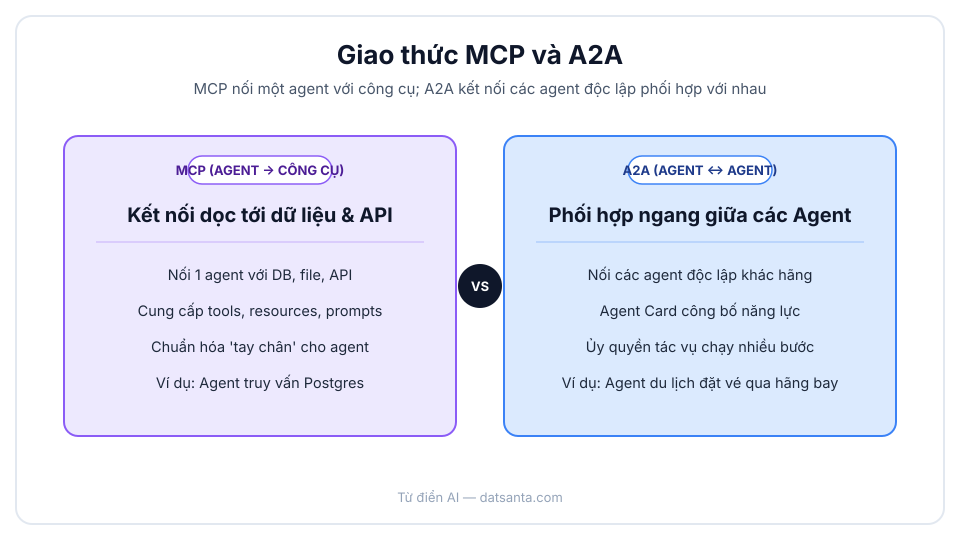

# A2A Protocol (Giao thức Agent-to-Agent)

**A2A (Agent-to-Agent)** là giao thức giao tiếp mở giúp các AI agent độc lập do nhiều đội ngũ hoặc framework khác nhau xây dựng có thể khám phá năng lực của nhau, trao đổi tác vụ và phối hợp qua HTTP/JSON chuẩn.

## Ví dụ thực tế

Tại sân bay, phi công, đội bốc xếp hành lý và kiểm soát không lưu thuộc các đơn vị khác nhau nhưng vẫn phối hợp nhịp nhàng nhờ nói chung quy chuẩn liên lạc hàng không. A2A làm đúng vai trò đó cho agent phần mềm: một agent lập kế hoạch du lịch có thể giao việc đặt vé cho agent của hãng hàng không thông qua Agent Card công khai mà không cần chia sẻ prompt hay mã nguồn nội bộ.

## Đừng nhầm với

- **[MCP (Model Context Protocol)](mcp.md):** MCP kết nối một agent tới *công cụ và nguồn dữ liệu* bên ngoài (chiều dọc); A2A kết nối *các agent ngang hàng* để ủy quyền công việc cho nhau (chiều ngang).

## Thuật ngữ liên quan

- [MCP](mcp.md)
- [Multi-Agent System](multi-agent-system.md)
- [Handoff](handoff.md)
