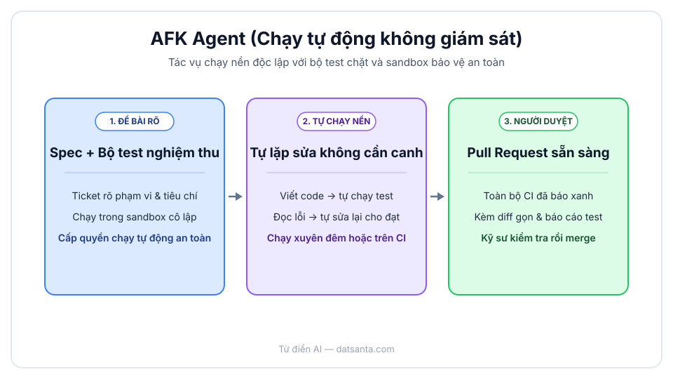

# AFK Agent (Agent chạy tự động không cần giám sát)

**AFK agent (Away From Keyboard)** là luồng coding agent tự chủ được kích hoạt chạy nền—không cần con người ngồi canh hay bấm duyệt từng lệnh—thường nằm trong [sandbox](sandbox.md) cô lập hoặc CI cho tới khi tự mở pull request.

## Ví dụ thực tế

Lập trình tương tác với AI giống như lái xe luôn đặt hai tay trên vô-lăng; AFK agent giống như xếp bát vào máy rửa bát trước khi đi ngủ để sáng dậy có bát sạch dùng ngay. Bạn đưa cho nó một bản [spec](spec.md) rõ ràng, bộ test tự động chặt chẽ và một sandbox an toàn, rồi để nó chạy xuyên đêm làm migration, viết thêm unit test hay sửa lỗi trong khi bạn tập trung vào thiết kế kiến trúc.

## Đừng nhầm với

- **[Human-in-the-Loop](human-in-the-loop.md):** Human-in-the-loop cần người tương tác sát cánh trong lúc chạy; AFK agent tự chạy độc lập trong hàng rào an toàn và chỉ chờ con người duyệt ở bước pull request cuối cùng.

## Thuật ngữ liên quan

- [Dark Factory](dark-factory.md)
- [Sandbox](sandbox.md)
- [Spec](spec.md)
