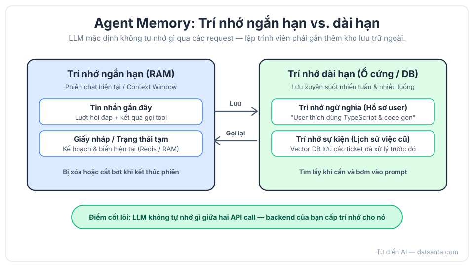

# Agent Memory (Bộ nhớ của Agent)

**Agent memory** là tầng lưu trữ do lập trình viên xây dựng quanh các [LLM](llm.md) vốn không có trạng thái, giúp [AI agent](ai-agent.md) giữ được ngữ cảnh trong tác vụ đang chạy (ngắn hạn) và nhớ thông tin qua nhiều phiên làm việc (dài hạn).

## Ví dụ thực tế

API của LLM giống một cố vấn giỏi nhưng mất sạch trí nhớ sau mỗi cuộc gọi. Trí nhớ ngắn hạn là tờ giấy nháp trên bàn trong cuộc gọi hiện tại (tin nhắn gần đây và biến tạm trong [context window](context-window.md) hoặc Redis).

Trí nhớ dài hạn là tủ hồ sơ lưu trong database hoặc [vector database](vector-database.md) — giữ sở thích người dùng (*"Thích TypeScript"*) và nhật ký các ticket cũ để gọi lại sau nhiều tuần.

## Đừng nhầm với

- **Trọng số mô hình (Training):** Training nạp kiến thức chung vào trọng số một lần; agent memory lưu dữ liệu riêng theo từng user trong database và cập nhật tức thì không cần train lại.
- **[RAG](rag.md):** RAG thường tra cứu tài liệu tĩnh của công ty; agent memory vừa đọc vừa ghi các thông tin động rút ra từ quá trình tương tác với user.

## Thuật ngữ liên quan

- [AI Agent](ai-agent.md)
- [Context Window](context-window.md)
- [Vector Database](vector-database.md)
- [RAG](rag.md)
