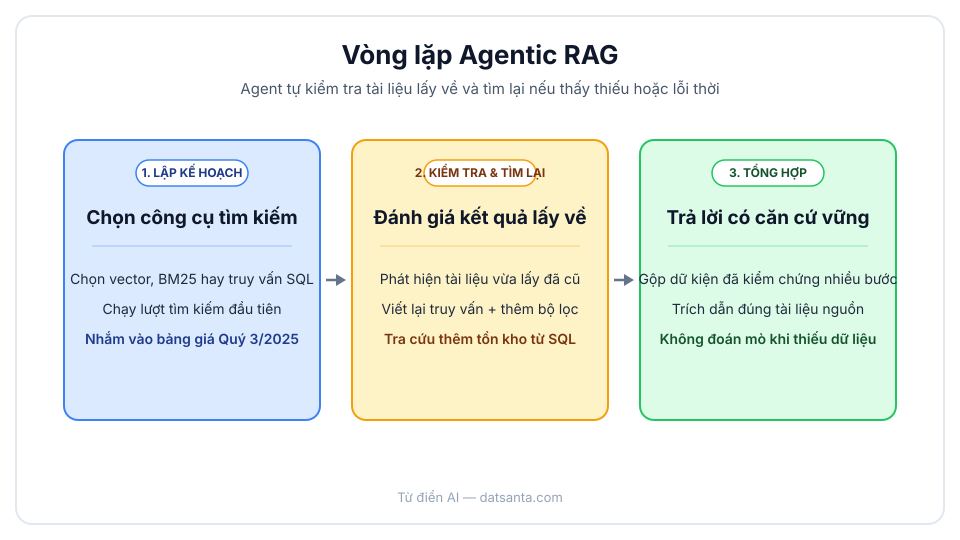

# Agentic RAG (RAG chủ động nhiều bước)

**Agentic RAG** thay thế luồng tìm-rồi-trả-lời một lần cứng nhắc bằng một AI agent biết tự lập kế hoạch tìm kiếm, kiểm tra tài liệu vừa lấy về, viết lại truy vấn nếu thiếu thông tin hoặc gọi thêm công cụ khác cho đến khi đủ bằng chứng.

## Ví dụ thực tế

RAG thông thường giống như việc cầm 5 cuốn sách thủ thư đưa rồi viết báo cáo ngay, kể cả khi có 3 cuốn lệch chủ đề. Agentic RAG làm việc như một nhà nghiên cứu thực thụ: xem kết quả lần 1 thấy bảng giá đã đổi vào quý 3, nó tự tìm lại lần 2 lọc theo năm `2025`, truy vấn thêm bảng SQL kiểm tra tồn kho rồi mới viết câu trả lời cuối.

## Đừng nhầm với

- **[GraphRAG](graph-rag.md):** GraphRAG thay đổi *cách lưu trữ và liên kết dữ liệu* (dạng đồ thị); agentic RAG thay đổi *cách điều phối quá trình tìm kiếm* (vòng lặp agent gọi công cụ nhiều bước).

## Thuật ngữ liên quan

- [RAG](rag.md)
- [ReAct Pattern](react-pattern.md)
- [Query Rewriting](query-rewriting.md)
