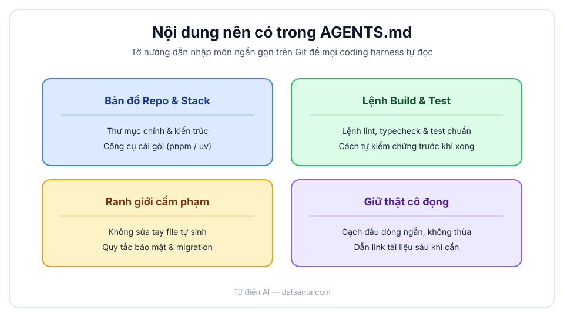

# AGENTS.md

**`AGENTS.md`** (tương tự `CLAUDE.md`) là tệp hướng dẫn dạng Markdown đặt ngay trong kho mã nguồn, chỉ dẫn cho các AI coding [harness](harness.md) biết cấu trúc dự án, lệnh chạy test và các quy tắc lập trình bắt buộc phải tuân thủ.

## Ví dụ thực tế

Khi một kỹ sư mới gia nhập nhóm, bạn đưa họ tờ hướng dẫn một trang: `"Dùng pnpm, không sửa tay file migration đã sinh, luôn chạy vitest trước khi commit."` `AGENTS.md` chính là tờ hướng dẫn nhập môn đó dành cho AI coding agent. Harness sẽ tự động nạp nó mỗi khi mở phiên mới để bạn không phải nhắc lại cùng một quy tắc ở mọi prompt—và giữ nó ngắn gọn giúp không làm phình [smart zone](smart-zone.md).

## Đừng nhầm với

- **[System Prompt](system-prompt.md):** System prompt là chỉ dẫn mặc định do hãng tạo ra công cụ AI viết; `AGENTS.md` là bộ quy tắc *riêng cho từng dự án* do chính đội ngũ kỹ sư của bạn viết và lưu trên Git.

## Thuật ngữ liên quan

- [Harness](harness.md)
- [Skill](skill.md)
- [Progressive Disclosure](progressive-disclosure.md)
