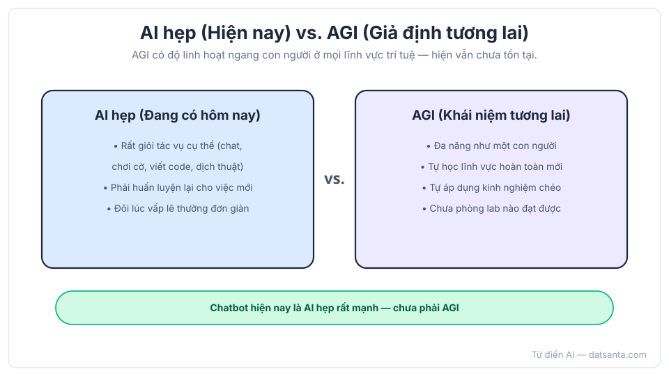

# AGI (Trí tuệ nhân tạo tổng quát)

**AGI** (Artificial General Intelligence) là dạng AI giả định trong tương lai có thể hiểu, học và thực hiện *mọi* công việc trí tuệ ngang tầm con người — thích nghi linh hoạt sang các lĩnh vực hoàn toàn mới mà không cần huấn luyện lại từ đầu.

## Ví dụ thực tế

Mọi hệ thống AI ngày nay đều là **AI hẹp (Narrow AI)**, kể cả các [LLM](llm.md) rất mạnh: AI có thể thắng kiện tướng cờ vua hay viết code rất nhanh, nhưng vẫn vấp ở những tình huống đời thường ngoài dữ liệu học hoặc không tự học được một nghề hoàn toàn mới.

AGI sẽ giống một người đa tài thực thụ — sáng học kế toán, chiều đọc bản vẽ kỹ thuật và tự áp dụng kinh nghiệm từ việc này sang việc khác. Hiện tại AGI vẫn chưa tồn tại.

## Đừng nhầm với

- **[LLM](llm.md) hay [AI agent](ai-agent.md) hiện nay:** Chatbot ngày nay nói chuyện rất giống người, nhưng vẫn thiếu sự thấu hiểu thật sự, khả năng tự học liên tục và lẽ thường vững chắc ở mọi lĩnh vực.
- **Ý thức trong phim viễn tưởng:** AGI nói về *năng lực giải quyết vấn đề tổng quát*, không đồng nghĩa với việc máy có cảm xúc hay tự nhận thức.

## Thuật ngữ liên quan

- [AI](ai.md)
- [Foundation Model](foundation-model.md)
- [AI Alignment](ai-alignment.md)
- [Reasoning Model](reasoning-model.md)
