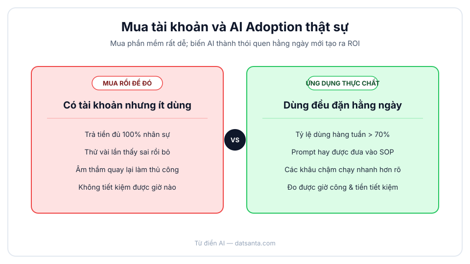

# AI Adoption (Mức độ ứng dụng AI)

**AI adoption** là mức độ nhân sự trong một tổ chức thực sự đưa AI vào công việc hằng ngày một cách đều đặn, thay vì chỉ đăng ký tài khoản hoặc dùng thử vài lần rồi bỏ.

## Ví dụ thực tế

Mua thẻ tập gym cho toàn bộ 200 nhân viên không tự động giúp công ty khỏe mạnh hơn. Giá trị thật chỉ xuất hiện khi mọi người đều đặn đến tập 3 buổi mỗi tuần vì lịch tập hợp lý và dễ duy trì. Với AI cũng vậy: trả tiền mua tài khoản hàng loạt sẽ thành lãng phí nếu sau hai tuần nhân viên lại âm thầm quay về làm thủ công. AI adoption thể hiện qua tỷ lệ dùng hằng tuần và số giờ tiết kiệm được.

## Đừng nhầm với

- **[AI Enablement](ai-enablement.md):** Enablement là việc cung cấp khóa học, tài liệu mẫu và công cụ; AI adoption là hành vi sử dụng thực tế của nhân viên sau đó.

## Thuật ngữ liên quan

- [Change Management](change-management.md)
- [AI Pilot](ai-pilot.md)
- [Productivity J-Curve](productivity-j-curve.md)
