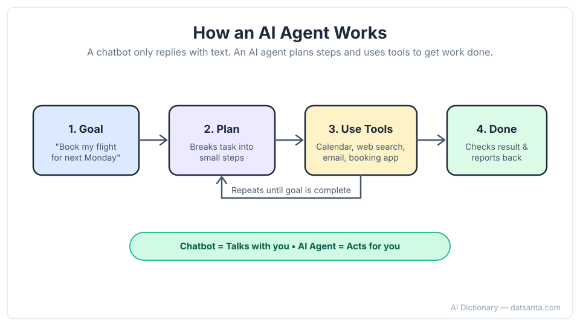

# AI Agent (Tác nhân AI)

**AI agent** là hệ thống AI không chỉ biết nhắn tin trả lời — nó có thể tự lập kế hoạch, sử dụng các công cụ bên ngoài và thực hiện chuỗi hành động để hoàn thành mục tiêu cho bạn.

## Ví dụ đời thường

Một chatbot thông thường giống như người tư vấn qua điện thoại: bạn hỏi *"Tối nay ăn gì?"*, nó gợi ý 3 quán rồi bạn tự lo phần còn lại.

Còn AI agent giống một trợ lý cá nhân thực thụ: bạn nhắn *"Đặt giúp bàn yên tĩnh cho 2 người lúc 7 giờ tối gần văn phòng"*, nó tự kiểm tra lịch của bạn, tìm quán phù hợp, đặt bàn và gửi lại xác nhận.

## Đừng nhầm với

- **Chatbot:** Chatbot chỉ chờ bạn nhắn rồi trả lời bằng chữ; AI agent tự lặp qua các bước lập kế hoạch, dùng công cụ (lịch, tìm kiếm, email, code) và tự kiểm tra kết quả.
- **Script tự động hóa:** Script truyền thống chỉ chạy theo một đường thẳng cố định; AI agent biết tự điều chỉnh kế hoạch khi gặp tình huống phát sinh.

## Thuật ngữ liên quan

- [LLM](llm.md)
- [Prompt](prompt.md)
- [RAG](rag.md)
