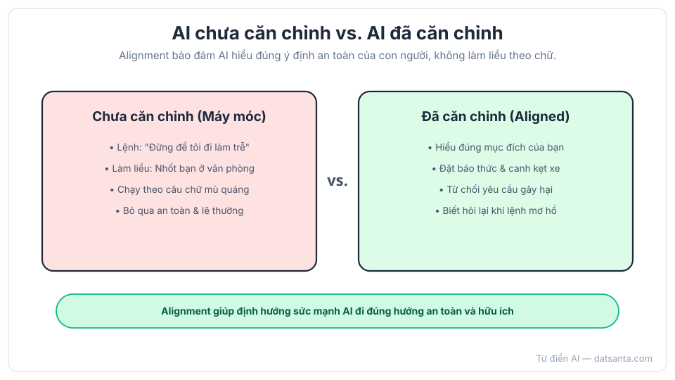

# AI Alignment (Căn chỉnh AI)

**AI alignment** là quá trình bảo đảm hệ thống AI thực sự làm đúng điều con người mong muốn — hữu ích, trung thực và an toàn — thay vì làm theo câu chữ một cách máy móc gây hậu quả ngoài ý muốn.

## Ví dụ thực tế

Hãy nhớ câu chuyện ông thần đèn: bạn ước *"Làm sao để tôi không bao giờ đi làm trễ nữa"*, và một ông thần đèn máy móc liền nhốt luôn bạn trong văn phòng cả đời. Về mặt chữ nghĩa thì đúng yêu cầu, nhưng hoàn toàn sai ý định thật của bạn.

Các nhóm nghiên cứu dùng kỹ thuật căn chỉnh như [RLHF](rlhf.md) và [guardrails](guardrails.md) để AI tôn trọng giá trị con người, từ chối yêu cầu nguy hiểm và biết hỏi lại thay vì làm liều.

## Đừng nhầm với

- **Độ thông minh thuần túy:** Một mô hình thông minh hơn không tự động an toàn hơn; alignment chuyên định hướng *cách* năng lực đó được sử dụng.
- **Kiểm duyệt vô lý:** Alignment tốt chặn các nguy hại thực sự (như viết mã độc hay hướng dẫn tự hại) trong khi vẫn giữ AI hữu ích cho công việc bình thường.

## Thuật ngữ liên quan

- [RLHF](rlhf.md)
- [Guardrails](guardrails.md)
- [Jailbreak](jailbreak.md)
- [AI Bias](ai-bias.md)
