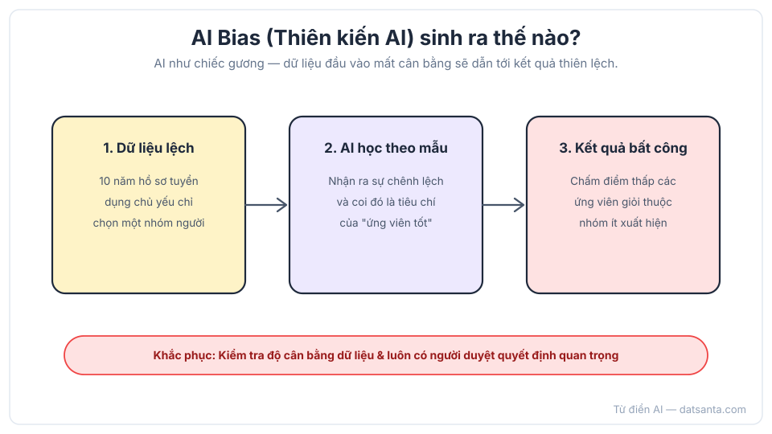

# AI Bias (Thiên kiến AI)

**AI bias** xảy ra khi hệ thống AI đưa ra kết quả thiếu công bằng, lệch lạc hoặc mang định kiến vì nó học từ những ví dụ mất cân bằng của con người trong [training data](training-data.md).

## Ví dụ thực tế

Giả sử một công ty huấn luyện AI lọc hồ sơ tuyển dụng dựa trên dữ liệu 10 năm qua của một phòng ban vốn chủ yếu tuyển nam giới. Dù không ai lập trình để phân biệt đối xử, AI vẫn nhận ra quy luật đó và âm thầm đánh điểm thấp các ứng viên nữ đủ năng lực.

AI không tự nhiên "khách quan" chỉ vì nó chạy bằng toán học — nó giống chiếc gương phản chiếu đúng những điểm mù có sẵn trong dữ liệu chúng ta đưa vào.

## Đừng nhầm với

- **[Hallucination](hallucination.md):** Hallucination là tự bịa ra một thông tin sai; AI bias là sự thiên vị có hệ thống đối với một nhóm người, ngôn ngữ hay góc nhìn nào đó.
- **Ý kiến cá nhân:** AI không có cảm xúc hay ác ý — thiên kiến bắt nguồn từ dữ liệu lệch, thiếu đại diện hoặc cách thiết kế chưa kỹ.

## Thuật ngữ liên quan

- [Training Data](training-data.md)
- [AI Alignment](ai-alignment.md)
- [AI Governance](ai-governance.md)
- [AI Literacy](ai-literacy.md)
