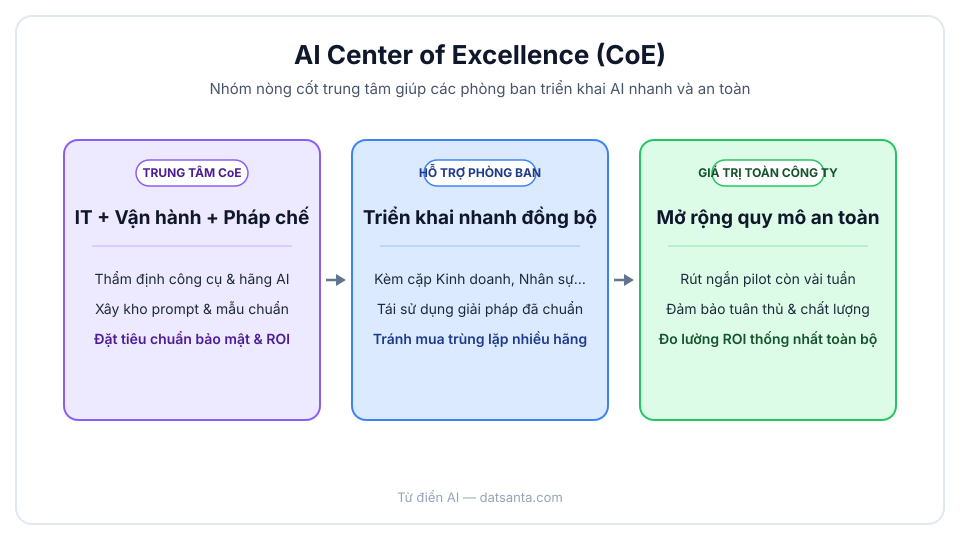

# AI Center of Excellence (Trung tâm Điều phối AI)

**AI Center of Excellence (CoE)** là một nhóm nòng cốt liên phòng ban trong công ty chuyên đặt ra tiêu chuẩn AI, chia sẻ bộ prompt mẫu hiệu quả, thẩm định công cụ an toàn và hỗ trợ các bộ phận triển khai đồng bộ.

## Ví dụ thực tế

Thay vì để marketing, nhân sự và tài chính tự mày mò đàm phán với các hãng AI khác nhau rồi lặp lại cùng một lỗi bảo mật, CoE đóng vai trò như đội kỹ thuật đường đua dùng chung. Chỉ khoảng 3–5 người từ IT, vận hành và pháp chế sẽ thẩm định sẵn công cụ an toàn, giúp từng phòng ban đưa AI vào chạy thật chỉ trong vài tuần thay vì mất nhiều tháng tự dò đường.

## Đừng nhầm với

- **[AI Champion](ai-champion.md):** CoE là đầu mối chuyên môn trung tâm của cả công ty; AI champion là nhân sự tiên phong nằm ngay trong từng phòng ban cụ thể như kinh doanh hay chăm sóc khách hàng.

## Thuật ngữ liên quan

- [AI Enablement](ai-enablement.md)
- [AI Governance](ai-governance.md)
- [AI Champion](ai-champion.md)
