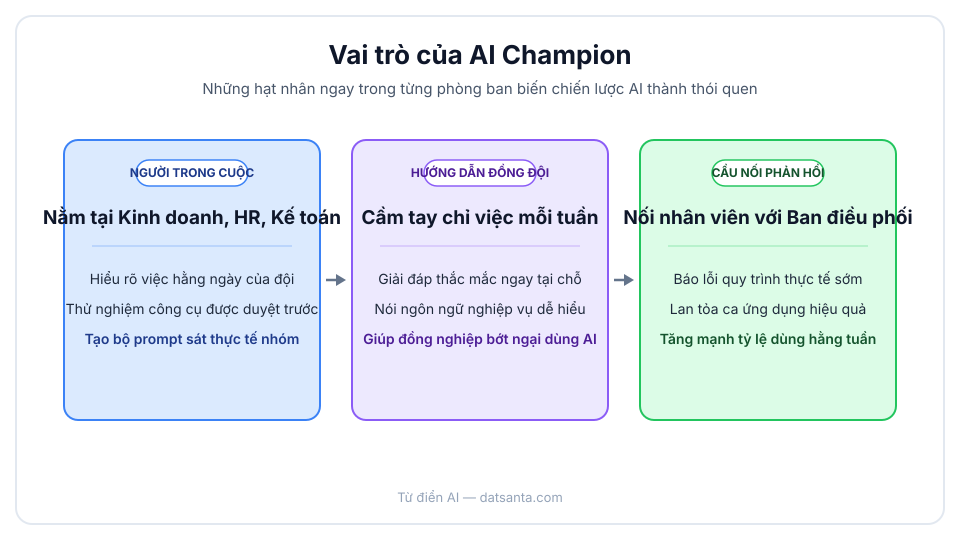

# AI Champion (Hạt nhân AI nội bộ)

**AI champion** là một nhân viên nhiệt huyết, thực tế ngay trong các phòng ban nghiệp vụ—như kinh doanh, nhân sự hay kế toán—người tiên phong thử nghiệm quy trình AI và trực tiếp hướng dẫn đồng nghiệp áp dụng hằng ngày.

## Ví dụ thực tế

Khi bệnh viện áp dụng phần mềm đặt lịch mới, bác sĩ hiếm khi ngồi đọc cuốn tài liệu IT dày 60 trang. Họ sẽ hỏi ngay người đồng nghiệp cùng khoa đã rành phần mềm và hiểu rõ lịch trực của họ. AI champion đóng đúng vai trò cầu nối đó: biến các tính năng AI trừu tượng thành mẹo làm việc thiết thực cho phòng ban mình và phản hồi vướng mắc thực tế lên ban quản lý.

## Đừng nhầm với

- **[AI Center of Excellence (CoE)](ai-center-of-excellence.md):** CoE là đội chuyên trách trung tâm lo quy chuẩn và hạ tầng toàn công ty; AI champion là người đồng hành tin cậy ngay trong từng đội nhóm nghiệp vụ.

## Thuật ngữ liên quan

- [AI Adoption](ai-adoption.md)
- [Change Management](change-management.md)
- [AI Enablement](ai-enablement.md)
