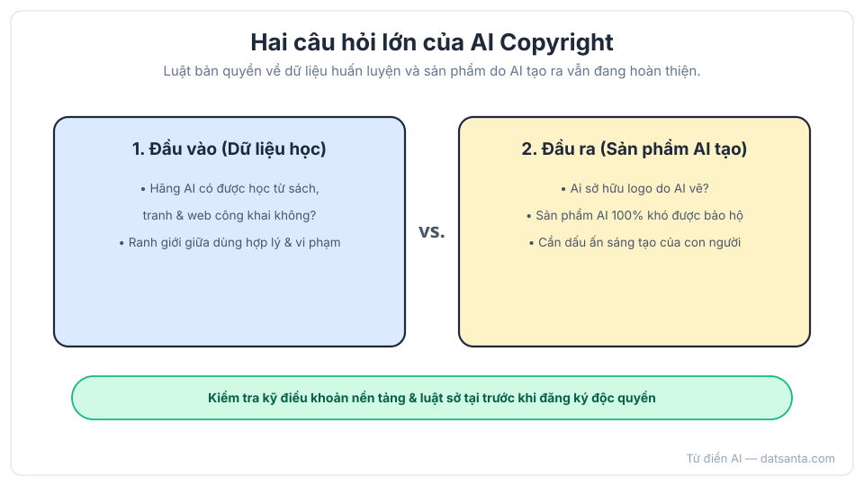

# AI Copyright (Bản quyền AI)

**AI copyright** bao gồm các vấn đề pháp lý xoay quanh việc ai sở hữu chữ viết, tranh ảnh hay nhạc do AI tạo ra — và liệu các hãng AI có được dùng sách, ảnh có bản quyền làm [training data](training-data.md) hay không.

## Ví dụ thực tế

Giả sử bạn nhờ AI vẽ một tách cà phê rồi in lên áo thun bán. Tại nhiều quốc gia, sản phẩm do AI tạo hoàn toàn mà không có sự sáng tạo đáng kể từ con người sẽ không được cấp bản quyền — nghĩa là người khác cũng có thể sao chép hình đó.

Song song đó, tác giả và họa sĩ vẫn đang tranh luận việc dùng tác phẩm công khai để dạy AI có hợp pháp hay vi phạm bản quyền. Luật pháp từng nước hiện vẫn đang hoàn thiện dần.

## Đừng nhầm với

- **Giấy phép (MIT / CC):** Giấy phép là quyền cho phép do tác giả tự chọn; bản quyền là sự bảo hộ mặc định của pháp luật cho tác phẩm con người sáng tạo.
- **Quyền thương mại của nền tảng:** Dù app AI cho phép bạn bán ảnh vừa tạo, luật bản quyền vẫn có thể từ chối quyền sở hữu độc quyền nếu thiếu dấu ấn con người.

## Thuật ngữ liên quan

- [Training Data](training-data.md)
- [Generative AI](generative-ai.md)
- [Responsible AI](responsible-ai.md)
- [AI Watermark](ai-watermark.md)
