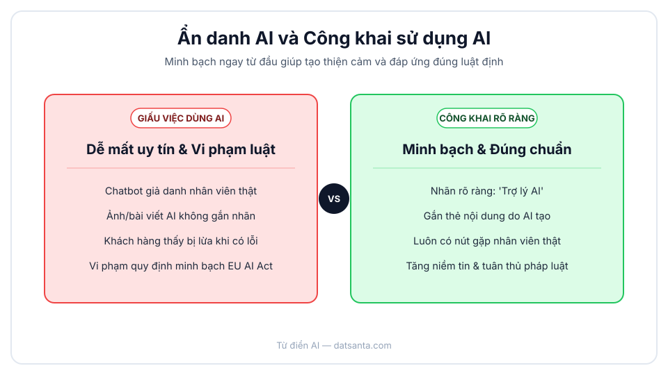

# AI Disclosure (Công khai sử dụng AI)

**AI disclosure** là việc thông báo rõ ràng cho khách hàng, nhân viên hoặc công chúng biết khi họ đang trò chuyện với hệ thống AI hoặc đang xem nội dung, hình ảnh, âm thanh do AI tạo ra.

## Ví dụ thực tế

Khi bạn mở khung chat hỗ trợ của ngân hàng và dòng đầu tiên hiện lên: "Xin chào, tôi là trợ lý AI—gõ 'nhân viên' bất cứ lúc nào để gặp người thật", đó chính là AI disclosure. Tương tự, gắn nhãn ảnh sản phẩm tạo bằng AI hay báo cho ứng viên biết hồ sơ được sàng lọc tự động giúp tránh gây hiểu lầm, đáp ứng quy định như EU AI Act và giữ thiện cảm với người dùng.

## Đừng nhầm với

- **[Customer Trust](customer-trust.md):** AI disclosure là nhãn thông báo hoặc lời nhắc minh bạch; customer trust là niềm tin bền vững mà doanh nghiệp nhận lại nhờ sự trung thực và chất lượng phục vụ.

## Thuật ngữ liên quan

- [Customer Trust](customer-trust.md)
- [EU AI Act](eu-ai-act.md)
- [Escalation Path](escalation-path.md)
