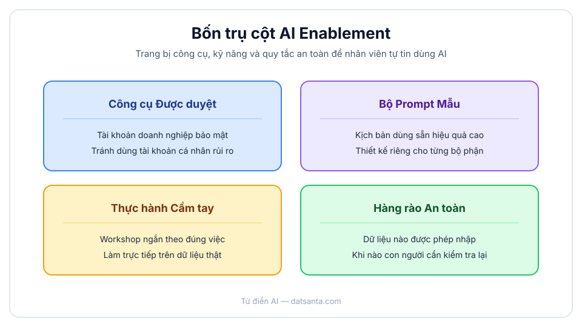

# AI Enablement (Trang bị năng lực AI)

**AI enablement** là việc trang bị cho nhân viên kiến thức thực hành, công cụ được duyệt, thư viện prompt mẫu và quy tắc an toàn để họ tự tin dùng AI ngay trong công việc hằng ngày.

## Ví dụ thực tế

Giao chìa khóa xe hơi cho người chưa biết lái mà không có khóa học, biển báo hay bảo hiểm thì hoặc xe nằm im trong gara, hoặc dễ xảy ra tai nạn. Enablement chính là khóa học lái, luật giao thông rõ ràng và sân tập an toàn. Trong doanh nghiệp, AI enablement gồm các buổi hướng dẫn theo từng phòng ban, bộ prompt chuẩn và quy định rõ dữ liệu nào được phép đưa vào AI.

## Đừng nhầm với

- **[AI Adoption](ai-adoption.md):** Enablement là hệ thống hỗ trợ bạn xây dựng cho nhân viên; adoption là kết quả sử dụng thực tế hằng ngày.

## Thuật ngữ liên quan

- [Change Management](change-management.md)
- [AI Readiness](ai-readiness.md)
- [AI Strategy](ai-strategy.md)
