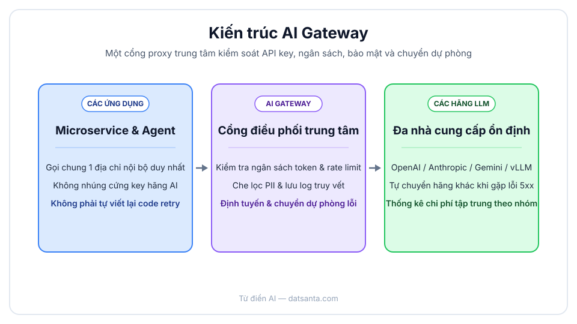

# AI Gateway (Cổng điều phối AI)

**AI gateway** là máy chủ proxy thống nhất nằm giữa code ứng dụng của bạn và các nhà cung cấp LLM bên ngoài—xử lý tập trung API key, [rate limiting](rate-limiting.md), [fallback chain](fallback-chain.md), theo dõi chi phí và [observability](observability.md).

## Ví dụ thực tế

Thay vì để 15 microservice tự nhúng SDK của OpenAI, Anthropic và Gemini với hàng chục API key rải rác, mọi dịch vụ chỉ gọi vào một cổng gateway nội bộ duy nhất. Nếu Hãng A gặp sự cố, gateway tự chuyển sang Hãng B; nếu prompt có chứa PII, nó lọc ngay tại cổng; và bộ phận tài chính có một bảng thống kê chi phí token rõ ràng cho từng tính năng.

## Đừng nhầm với

- **[Model Routing](model-routing.md):** Model routing là quy tắc thông minh chọn *model nào* hợp với độ khó câu hỏi; AI gateway là hạ tầng proxy trung tâm thực thi bảo mật, ngân sách, log và cả quy tắc routing đó.

## Thuật ngữ liên quan

- [Fallback Chain](fallback-chain.md)
- [Model Routing](model-routing.md)
- [Observability](observability.md)
