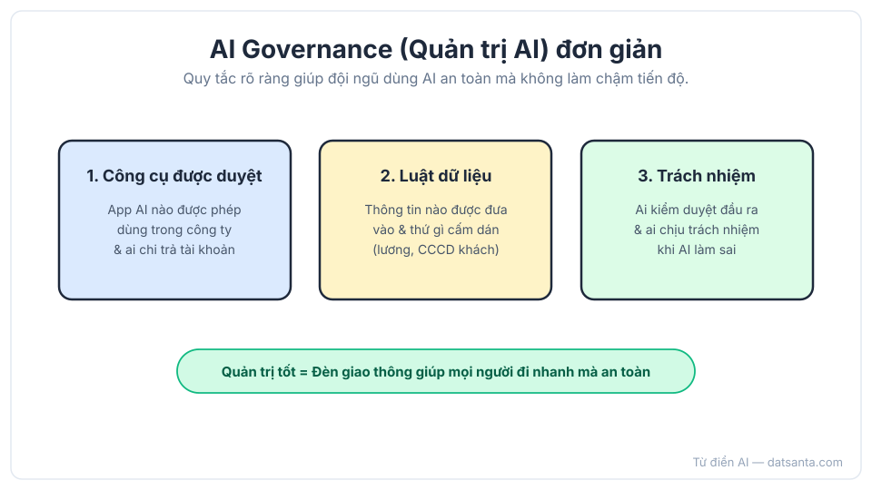

# AI Governance (Quản trị AI)

**AI governance** là bộ quy tắc rõ ràng trong doanh nghiệp để quy định công cụ AI nào được phép dùng, dữ liệu nào được phép đưa vào và ai chịu trách nhiệm khi AI làm sai.

## Ví dụ đời thường

Hãy nghĩ đến luật giao thông, dây an toàn và bằng lái xe. Chúng không sinh ra để cấm xe chạy — mà để mọi người đi nhanh hơn mà không đâm vào nhau.

AI governance tốt trong doanh nghiệp cũng vậy. Thay vì một cuốn quy chế 100 trang chẳng ai đọc, bạn chỉ cần hướng dẫn gọn 1 trang: *"Dùng tài khoản AI công ty cấp, không dán thông tin định danh khách hàng, và luôn đọc lại bản nháp trước khi gửi."*

## Đừng nhầm với

- **Cấm dùng AI:** Nói "cấm tuyệt đối AI" không phải là quản trị; cách đó thường đẩy nhân viên sang dùng [shadow AI](shadow-ai.md).
- **[Guardrails](guardrails.md):** Governance là chính sách và quy trình quản lý của con người; còn guardrails là bộ lọc kỹ thuật cài sẵn trong phần mềm AI.

## Thuật ngữ liên quan

- [Shadow AI](shadow-ai.md)
- [Data Privacy](data-privacy.md)
- [Guardrails](guardrails.md)
- [Human-in-the-Loop](human-in-the-loop.md)
