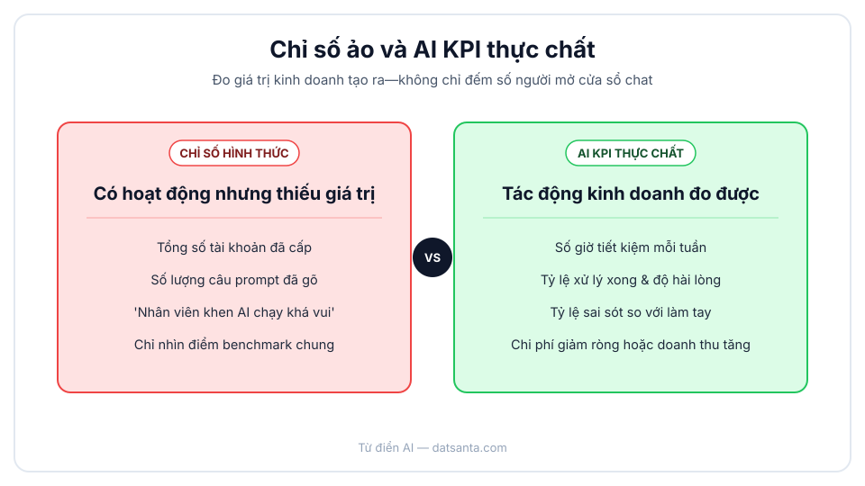

# AI KPI (Chỉ số đo lường AI)

**AI KPI** là con số cụ thể, đo lường được dùng để đánh giá xem dự án AI có thực sự mang lại giá trị kinh doanh hay không—như số giờ tiết kiệm, tỷ lệ xử lý thành công hoặc mức giảm sai sót.

## Ví dụ thực tế

Nói "trợ lý AI mới khá hữu ích cho đội kinh doanh" chỉ là cảm nhận, không phải KPI. Đo được "thời gian soạn báo giá giảm từ 90 phút xuống 25 phút trong khi tỷ lệ chốt đơn vẫn giữ trên 22%" mới là AI KPI. Các đội triển khai hiệu quả luôn thống nhất 2–3 KPI kinh doanh ngay trước khi chạy thử nghiệm để sau 30 ngày biết rõ nên tiếp tục hay dừng lại.

## Đừng nhầm với

- **[Benchmark](benchmark.md):** Benchmark kiểm tra trí thông minh chung của model trên các bộ đề chuẩn; AI KPI đo tác động kinh doanh thực tế bên trong doanh nghiệp của bạn.

## Thuật ngữ liên quan

- [AI Pilot](ai-pilot.md)
- [AI ROI](ai-roi.md)
- [Productivity J-Curve](productivity-j-curve.md)
