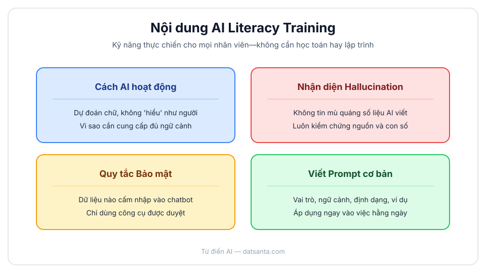

# AI Literacy Training (Đào tạo hiểu biết AI phổ thông)

**AI literacy training** trang bị cho nhân viên kiến thức thực tế về cách AI vận hành—AI làm tốt việc gì, vì sao hay bịa đặt (hallucinate), cách viết prompt rõ ràng và dữ liệu nào tuyệt đối không được nhập vào.

## Ví dụ thực tế

Dạy nhân viên lái xe an toàn không có nghĩa là biến tất cả thành thợ máy biết tháo lắp động cơ. Tương tự, đào tạo hiểu biết AI cho nhân viên marketing hay kế toán không cần dạy toán xác suất hay lập trình Python. Chỉ một buổi hướng dẫn 2 tiếng kèm ví dụ thật về lỗi sai của AI, quy tắc bảo mật và thói quen kiểm chứng đã giúp cả công ty làm việc nhanh và an toàn hơn hẳn.

## Đừng nhầm với

- **[AI Enablement](ai-enablement.md):** AI literacy training xây dựng nền tảng hiểu biết và thói quen an toàn; enablement đi xa hơn bằng việc cấp công cụ được duyệt, bộ prompt mẫu và tích hợp vào quy trình.

## Thuật ngữ liên quan

- [AI Enablement](ai-enablement.md)
- [Shadow IT](shadow-it.md)
- [Hallucination](hallucination.md)
