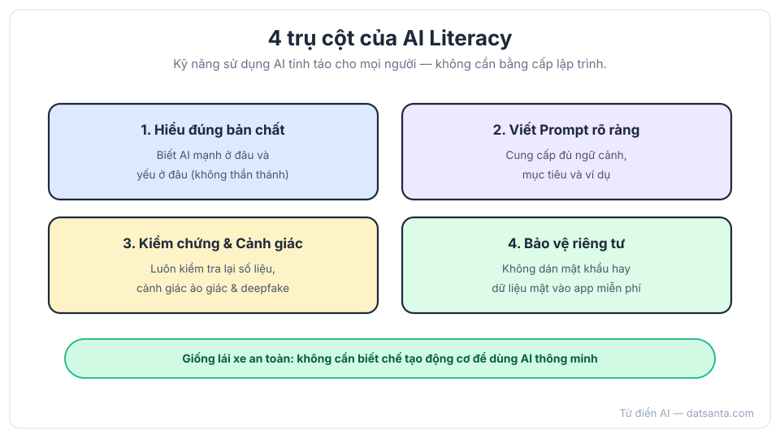

# AI Literacy (Năng lực hiểu biết AI)

**AI literacy** là kỹ năng thiết yếu hằng ngày giúp bạn hiểu AI làm được gì và không làm được gì, dùng công cụ AI hiệu quả, nhận ra lỗi sai như [hallucination](hallucination.md) hay [deepfake](deepfake.md), và tự bảo vệ quyền riêng tư.

## Ví dụ thực tế

Giống như việc lái xe an toàn không đòi hỏi bạn phải biết chế tạo động cơ — chỉ cần thuộc luật giao thông, biết nhìn gương và căn khoảng cách phanh — AI literacy không hề yêu cầu bằng công nghệ thông tin.

Người có AI literacy biết viết [prompt](prompt.md) rõ ràng, luôn kiểm chứng lại số liệu trước khi trích dẫn AI, không dán mật khẩu hay thông tin mật vào app miễn phí lạ, và biết việc nào nên để con người tự làm.

## Đừng nhầm với

- **Kỹ sư AI / Lập trình:** Kỹ sư là người xây dựng và triển khai mô hình bằng code; AI literacy dành cho *tất cả mọi người* — từ học sinh, giáo viên đến quản lý và người dùng phổ thông.
- **Tin mù quáng hoặc sợ hãi thái quá:** AI literacy nằm ở sự tỉnh táo ở giữa: tận dụng AI ở nơi giúp tiết kiệm thời gian thật sự, và giữ sự hoài nghi lành mạnh ở những việc rủi ro cao.

## Thuật ngữ liên quan

- [Prompt Engineering](prompt-engineering.md)
- [Hallucination](hallucination.md)
- [Deepfake](deepfake.md)
- [AI Bias](ai-bias.md)
