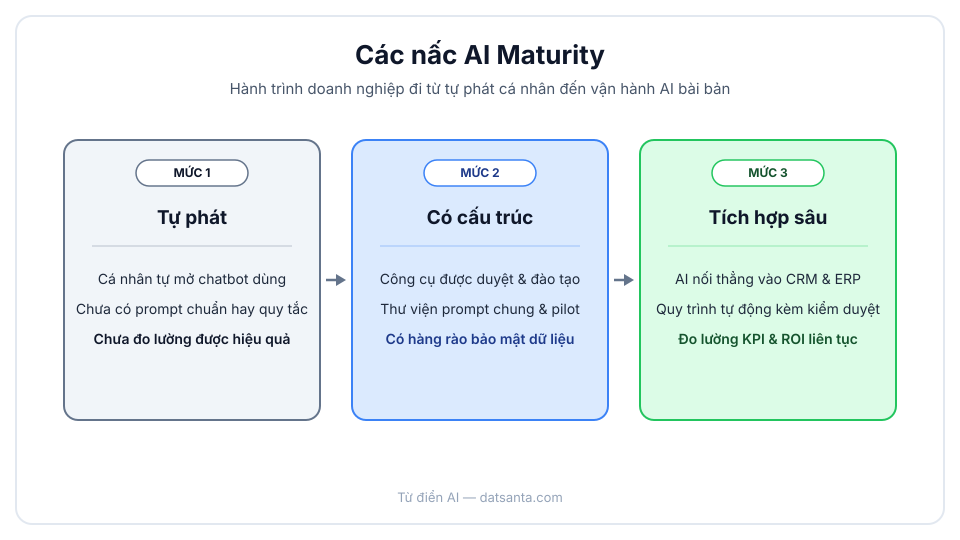

# AI Maturity (Mức độ trưởng thành AI)

**AI maturity** là thước đo cho thấy một tổ chức đang ở giai đoạn nào trên hành trình ứng dụng AI—từ chỗ vài cá nhân tự mày mò thử nghiệm, đến triển khai chuẩn hóa trên toàn doanh nghiệp với dữ liệu sạch và quy trình đo lường rõ ràng.

## Ví dụ thực tế

Một cửa hàng bán lẻ có thể đi từ việc ghi sổ tay, lên dùng Excel, rồi dùng phần mềm quản lý kho đồng bộ tự động theo thời gian thực. Mức độ trưởng thành AI cũng phát triển theo các nấc như vậy: ban đầu nhân viên tự mở chatbot viết email; tiến lên có thư viện prompt dùng chung; rồi đến mức AI kết nối trực tiếp vào CRM và ERP kèm quy trình kiểm soát rủi ro chặt chẽ.

## Đừng nhầm với

- **[AI Readiness](ai-readiness.md):** AI readiness hỏi "hiện tại bạn đã đủ điều kiện để bắt đầu chưa"; AI maturity đo "bạn đã đi được bao xa và vận hành AI bài bản đến mức nào".

## Thuật ngữ liên quan

- [AI Readiness](ai-readiness.md)
- [AI Strategy](ai-strategy.md)
- [AI Adoption](ai-adoption.md)
