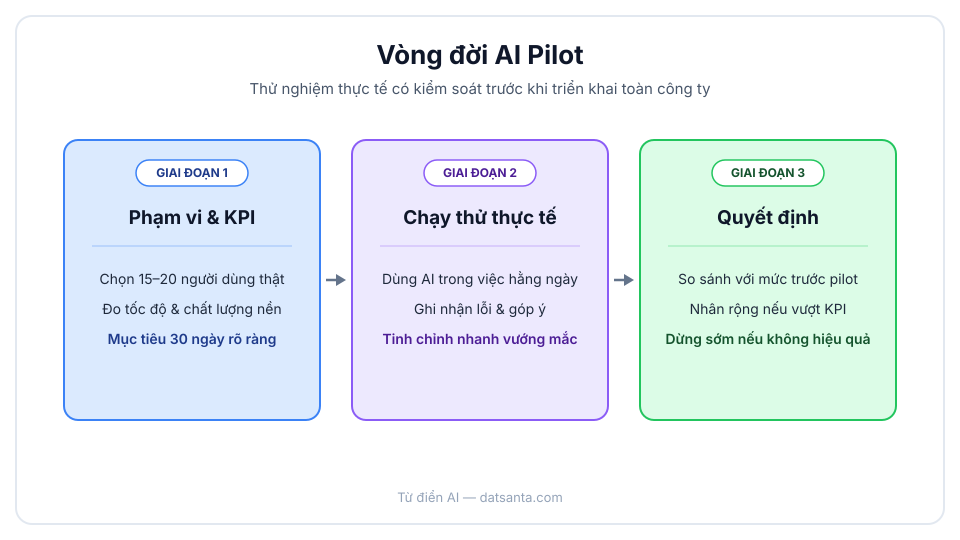

# AI Pilot (Thử nghiệm AI)

**AI pilot** là giai đoạn đưa giải pháp AI vào thử nghiệm có kiểm soát với một nhóm người dùng thật và chỉ số đo lường rõ ràng, nhằm kiểm chứng giá trị thực tế trước khi mở rộng toàn công ty.

## Ví dụ thực tế

Một chuỗi bán lẻ muốn dùng AI gợi ý trả lời khiếu nại khách hàng. Thay vì bật tính năng cho toàn bộ 200 nhân viên chăm sóc khách hàng cùng lúc, họ chạy pilot trong 30 ngày với một nhóm 15 người ở một chi nhánh, theo dõi thời gian phản hồi và mức độ hài lòng của khách. Nếu kết quả đạt mục tiêu đề ra, công ty mới nhân rộng; nếu không, họ dừng lại hoặc chỉnh sửa mà không gây xáo trộn lớn.

## Đừng nhầm với

- **[Proof of Concept (PoC)](proof-of-concept.md):** PoC chứng minh AI có khả năng xử lý dữ liệu về mặt kỹ thuật; AI pilot đo xem con người có thực sự dùng tốt và tạo ra giá trị kinh doanh hay không.

## Thuật ngữ liên quan

- [AI KPI](ai-kpi.md)
- [AI Adoption](ai-adoption.md)
- [Change Management](change-management.md)
