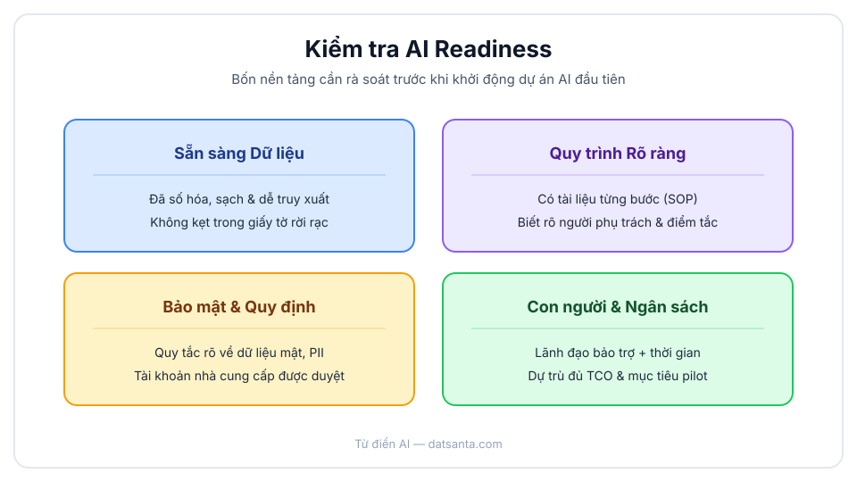

# AI Readiness (Mức độ sẵn sàng AI)

**AI readiness** là mức độ chuẩn bị của doanh nghiệp về dữ liệu, hạ tầng kỹ thuật, ngân sách, pháp lý và kỹ năng nhân sự trước khi bắt tay vào triển khai AI thực tế.

## Ví dụ thực tế

Trước khi lắp đặt hệ thống điện mặt trời, kỹ sư phải kiểm tra mái nhà có đủ chắc không, đường dây điện có chịu tải được không và ngân sách có đủ chi trả chi phí lắp đặt ban đầu hay không. Tương tự, đánh giá AI readiness giúp bạn phát hiện sớm những điểm nghẽn—như dữ liệu khách hàng còn nằm rải rác trên giấy, chưa có quy định bảo mật, hay nhân viên chưa quen làm việc số—để xử lý trước khi đổ tiền vào AI.

## Đừng nhầm với

- **[AI Maturity](ai-maturity.md):** AI readiness là bài kiểm tra điều kiện xuất phát trước khi làm; AI maturity phản ánh trình độ ứng dụng AI thực tế sau một thời gian triển khai.

## Thuật ngữ liên quan

- [AI Strategy](ai-strategy.md)
- [Process Mapping](process-mapping.md)
- [AI Enablement](ai-enablement.md)
