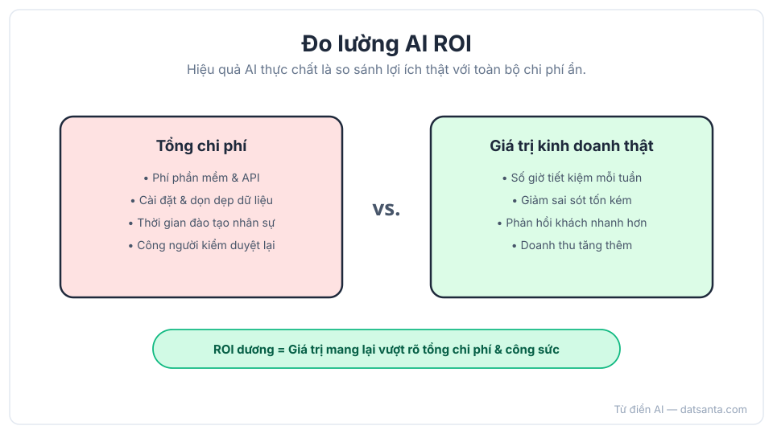

# AI ROI (Hiệu quả đầu tư AI)

**AI ROI** đo xem một dự án AI có thực sự giúp doanh nghiệp tiết kiệm hoặc kiếm thêm nhiều tiền hơn so với tổng chi phí xây dựng, vận hành và bảo trì hay không. ROI dương nghĩa là tạo ra giá trị thật, không chỉ là một bản demo đẹp mắt.

## Ví dụ thực tế

Giả sử một công cụ chăm sóc khách hàng tốn 500 USD/tháng và mất 40 giờ cài đặt. Nếu nó chỉ giúp đội ngũ tiết kiệm 2 giờ mỗi tháng, bài toán kinh tế rõ ràng không có lãi.

Ngược lại, nếu nó rút ngắn thời gian xử lý hóa đơn từ 3 giờ mỗi ngày xuống 20 phút và giảm sai sót, bạn sẽ thu hồi vốn sau vài tuần — miễn là đã tính đủ chi phí ẩn như làm sạch dữ liệu và kiểm duyệt.

## Đừng nhầm với

- **Tỷ lệ mở app:** 90% nhân viên mở chatbot vài lần mỗi tuần chưa phải ROI; thứ cần đo là giờ tiết kiệm, doanh thu tăng hoặc lỗi giảm.
- **Giá gói phần mềm:** Tiền thuê tool chỉ là một phần; chi phí tích hợp và kiểm duyệt thường tốn kém hơn.

## Thuật ngữ liên quan

- [Build vs. Buy](build-vs-buy.md)
- [AI Workflow](ai-workflow.md)
- [Human-in-the-Loop](human-in-the-loop.md)
