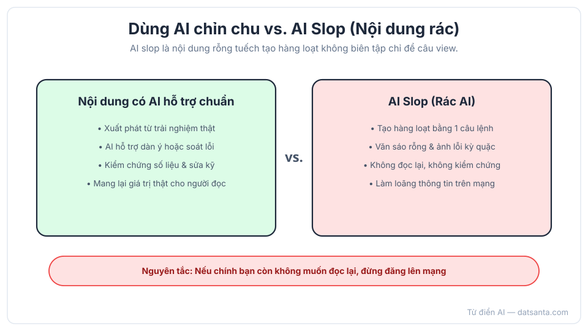

# AI Slop (Nội dung rác AI)

**AI slop** chỉ làn sóng văn bản, hình ảnh và video chất lượng thấp, lặp đi lặp lại hoặc sai lệch được tạo hàng loạt bằng AI rồi đăng tràn lan lên mạng xã hội và blog chỉ để câu view.

## Ví dụ thực tế

Hãy nghĩ tới đống tờ rơi quảng cáo nhét đầy hòm thư nhà bạn mỗi ngày. Trên mạng, AI slop hiện ra dưới dạng những bức ảnh AI kỳ quặc trên Facebook, các bài blog sáo rỗng mở đầu bằng *"Trong kỷ nguyên số phát triển vũ bão..."*, hay cẩm nang du lịch do người chưa từng tới đó viết bằng AI.

Cũng như spam, AI slop làm người đọc khó tìm thấy kinh nghiệm thật và bài viết chất lượng từ con người.

## Đừng nhầm với

- **Nội dung có AI hỗ trợ chỉn chu:** Dùng AI để gợi ý dàn ý, soát chính tả hay vẽ minh họa cho một bài viết được kiểm chứng kỹ là cách làm hiệu quả; AI slop bỏ qua hoàn toàn khâu biên tập của con người.
- **[Hallucination](hallucination.md):** Hallucination là lỗi AI vô tình đoán sai sự thật; AI slop là thói quen sản xuất ồ ạt nội dung nông cạn thiếu trách nhiệm.

## Thuật ngữ liên quan

- [Generative AI](generative-ai.md)
- [AI Watermark](ai-watermark.md)
- [AI Literacy](ai-literacy.md)
- [Hallucination](hallucination.md)
