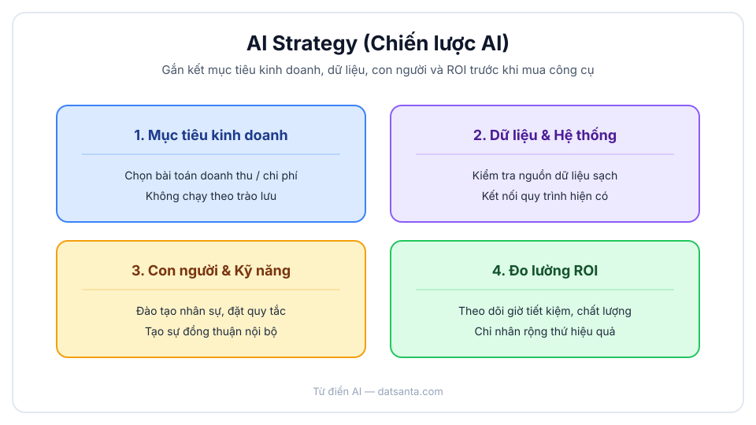

# AI Strategy (Chiến lược AI)

**AI strategy** là bản kế hoạch rõ ràng cho biết doanh nghiệp muốn dùng AI để giải quyết bài toán kinh doanh nào, nguồn lực và dữ liệu nào cần chuẩn bị, và làm sao đo lường hiệu quả thực tế.

## Ví dụ thực tế

Mở một nhà hàng thành công không bắt đầu bằng việc mua chiếc lò đắt tiền nhất rồi mới nghĩ xem sẽ bán món gì. Bạn phải xác định khách hàng mục tiêu, thực đơn chủ lực và ngân sách trước, rồi mới chọn thiết bị phù hợp. Tương tự, AI strategy giúp bạn tránh cảnh mua hàng loạt giấy phép AI đắt đỏ chỉ vì trào lưu, mà tập trung đúng vào khâu mang lại lợi nhuận hoặc tiết kiệm chi phí rõ rệt.

## Đừng nhầm với

- **[AI Pilot](ai-pilot.md):** Pilot là một đợt thử nghiệm nhỏ kéo dài vài tuần cho một bài toán cụ thể; AI strategy là bức tranh dài hạn dẫn đường cho mọi dự án đó.

## Thuật ngữ liên quan

- [AI Readiness](ai-readiness.md)
- [AI Maturity](ai-maturity.md)
- [Use Case Prioritization](use-case-prioritization.md)
