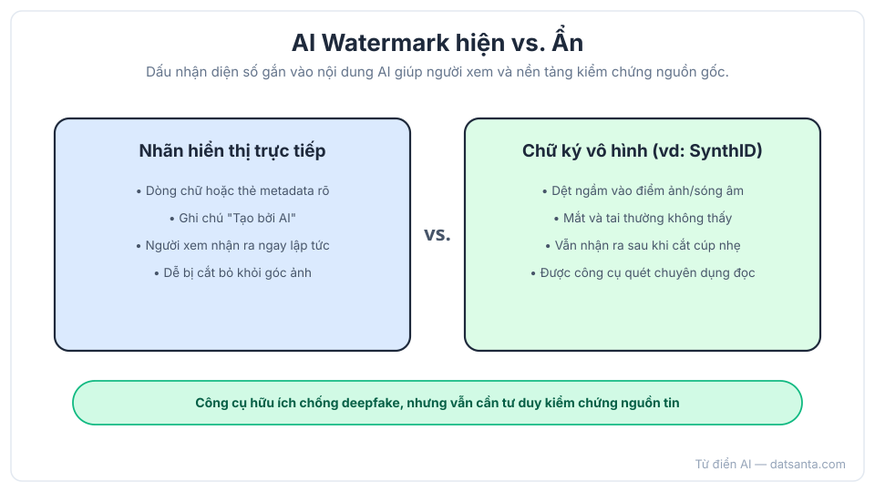

# AI Watermark (Dấu nhận diện AI)

**AI watermark** là nhãn hiển thị trực tiếp hoặc chữ ký số vô hình được nhúng vào ảnh, video, âm thanh hay văn bản do AI tạo ra để nền tảng và người xem xác minh nguồn gốc.

## Ví dụ thực tế

Giống như tờ tiền giấy có sợi bảo an ẩn chỉ hiện lên dưới đèn soi, các công nghệ hiện đại như SynthID dệt những mẫu điểm ảnh hoặc âm thanh siêu nhỏ, mắt thường không thấy vào sản phẩm AI.

Dấu ẩn này vẫn giữ nguyên chất lượng ảnh và thường sống sót cả khi ảnh bị cắt cúp nhẹ — giúp công cụ quét phát hiện *"Tạo bởi AI"*, hỗ trợ chống [deepfake](deepfake.md) và tin giả.

## Đừng nhầm với

- **Logo đóng dấu ảnh stock:** Dòng chữ mờ to đùng chắn giữa ảnh chỉ để chống tải lậu; AI watermark ẩn giữ nguyên vẻ đẹp bức ảnh mà vẫn chứng minh được xuất xứ.
- **Lá chắn tuyệt đối 100%:** Chưa có watermark nào không thể phá, đặc biệt dấu ẩn trong văn bản rất dễ mất khi viết lại câu — nên tư duy kiểm chứng vẫn rất cần thiết.

## Thuật ngữ liên quan

- [Deepfake](deepfake.md)
- [Text-to-Image](text-to-image.md)
- [AI Literacy](ai-literacy.md)
- [Diffusion Model](diffusion-model.md)
