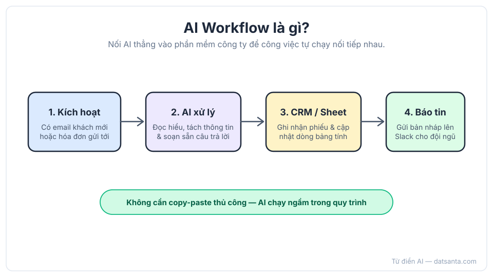

# AI Workflow (Quy trình tích hợp AI)

**AI workflow** là việc nối AI trực tiếp vào các công cụ làm việc sẵn có của doanh nghiệp — như email, CRM hay bảng tính — để các bước lặp đi lặp lại tự chạy nối tiếp nhau mà không cần copy-paste thủ công.

## Ví dụ đời thường

Việc copy từng email khách hàng dán vào ChatGPT, chờ trả lời rồi copy ngược lại vào phần mềm hỗ trợ giống như xách nước bằng xô.

Còn AI workflow là lắp luôn đường ống: cứ có email mới gửi tới, AI tự đọc nội dung, tra chính sách hoàn tiền, cập nhật một dòng vào CRM rồi gửi bản nháp lên Slack chờ bạn duyệt. Đội ngũ tiết kiệm hàng giờ mỗi ngày mà không phải chuyển qua lại nhiều tab.

## Đừng nhầm với

- **Chat với AI:** Nhắn tin trên trình duyệt là thao tác thủ công phụ thuộc vào từng cá nhân; AI workflow chạy tự động bên trong quy trình hằng ngày của công ty.
- **[AI agent](ai-agent.md):** AI workflow chạy theo các bước cố định bạn thiết kế sẵn; còn AI agent tự linh hoạt quyết định bước tiếp theo khi gặp nhiệm vụ mở.

## Thuật ngữ liên quan

- [AI Agent](ai-agent.md)
- [AI ROI](ai-roi.md)
- [Human-in-the-Loop](human-in-the-loop.md)
