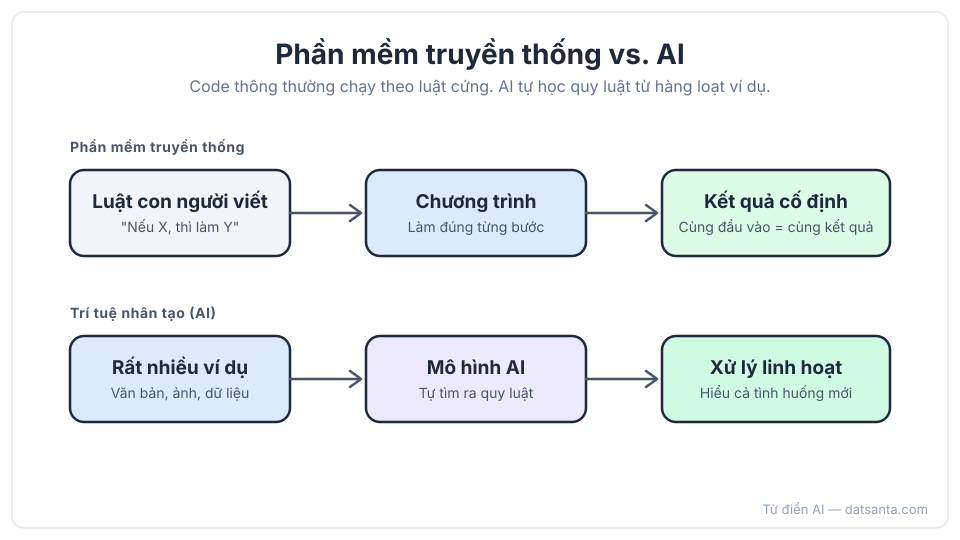

# AI (Trí tuệ nhân tạo)

**AI** là phần mềm được xây dựng để làm những việc thường đòi hỏi tư duy của con người — như hiểu ngôn ngữ, nhận diện hình ảnh hoặc ra quyết định. Thay vì chạy theo các quy tắc cứng nhắc được lập trình sẵn, AI hiện đại học quy luật từ hàng loạt ví dụ.

## Ví dụ thực tế

Hãy nghĩ tới sự khác biệt giữa máy bán nước tự động và một người pha chế. Máy bán nước làm theo quy tắc cố định: bạn bấm `B4`, máy nhả chai nước. Còn người pha chế nghe bạn nói *"cho ly gì mát mát, ít ngọt"* và tự biết cách pha dựa trên kinh nghiệm.

Phần mềm truyền thống giống máy bán nước. AI giống người pha chế — nó xử lý được những yêu cầu linh hoạt trong đời thực nhờ đã học qua hàng nghìn ví dụ trước đó.

## Đừng nhầm với

- **[Machine learning](machine-learning.md):** Phương pháp chính để tạo ra AI hiện đại, giúp máy tự học từ dữ liệu thay vì chờ con người viết từng dòng luật.
- **Tự động hóa (Automation):** Các tác vụ lặp đi lặp lại theo kịch bản cố định (như gửi hóa đơn mỗi thứ Sáu) không cần đến AI.

## Thuật ngữ liên quan

- [Machine learning](machine-learning.md)
- [Generative AI](generative-ai.md)
- [LLM](llm.md)
