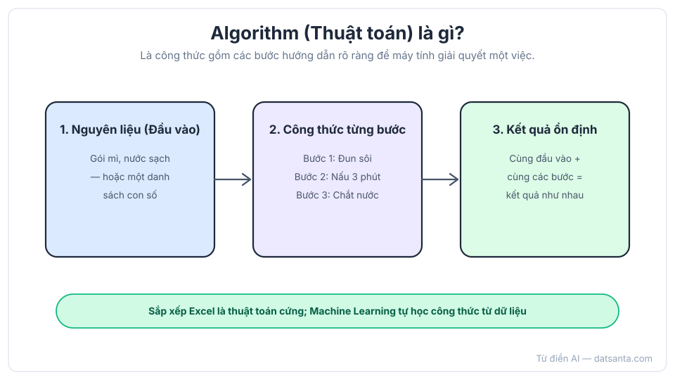

# Algorithm (Thuật toán)

**Algorithm** (thuật toán) là một công thức gồm các bước hướng dẫn rõ ràng, tuần tự mà máy tính làm theo để giải quyết bài toán, sắp xếp thông tin hoặc đưa ra quyết định.

## Ví dụ thực tế

Công thức nấu mì gói chính là một thuật toán: đun sôi nước, thả mì, chờ 3 phút, chắt nước. Làm đúng từng bước với cùng nguyên liệu thì lần nào cũng ra tô mì y hệt.

Phần mềm dùng thuật toán ở mọi nơi — từ tìm đường đi nhanh nhất trên Google Maps tới chọn video hiện tiếp theo trên bảng tin. Trong [machine learning](machine-learning.md), thuật toán là quy trình học giúp máy đọc hàng loạt ví dụ để tạo thành mô hình AI.

## Đừng nhầm với

- **[AI](ai.md):** Mọi hệ thống AI đều dùng thuật toán, nhưng phần lớn thuật toán (như sắp xếp bảng Excel theo A–Z hay tính thuế) chỉ là phép tính cố định, không phải AI.
- **Mô hình (Model):** Thuật toán là *phương pháp học* (cách đọc sách); mô hình đã huấn luyện là *bộ não thành phẩm* được lưu lại sau khi học xong [training data](training-data.md).

## Thuật ngữ liên quan

- [AI](ai.md)
- [Machine Learning](machine-learning.md)
- [Automation](automation.md)
- [Recommendation System](recommendation-system.md)
