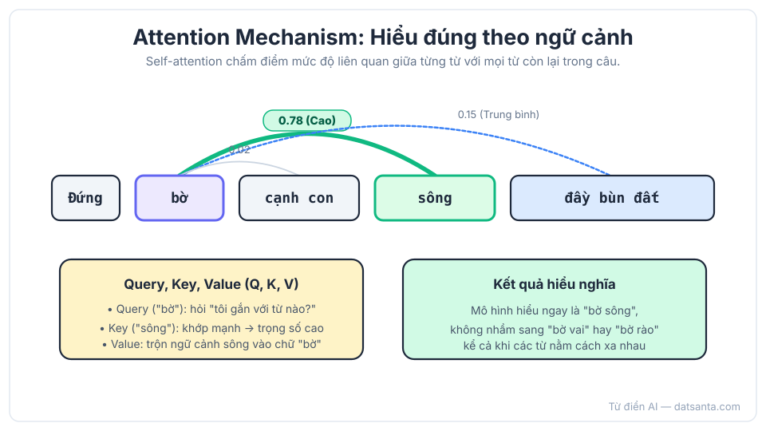

# Attention Mechanism (Cơ chế chú ý)

**Attention mechanism** cho phép mô hình [Transformer](transformer.md) tự động cân đo mức độ liên quan giữa từng từ với mọi từ khác trong câu, bất kể chúng đứng cách xa nhau bao nhiêu.

## Ví dụ đời thường

Khi đọc câu *"Đứng bờ cạnh con sông đầy bùn đất"*, não bạn lập tức nối chữ *"bờ"* với *"sông"* chứ không nghĩ sang *"bờ vai"* hay *"bờ rào"*.

Self-attention làm điều này bằng toán học thông qua 3 ma trận **Query, Key, Value**. Token `"bờ"` phát ra Query; `"sông"` khớp với Key tương ứng và nhận trọng số cao (`0.78`), trộn trực tiếp ngữ cảnh sông nước vào biểu diễn của chữ `"bờ"`.

## Đừng nhầm với

- **[Context window](context-window.md):** Context window là độ dài tối đa cho phép trên trang; attention là cơ chế tính liên kết từng cặp từ bên trong cửa sổ đó (khiến chi phí bộ nhớ tăng nhanh khi prompt dài).
- **Vector từ tĩnh:** Mô hình cũ gán cho một từ đúng một vector cố định; attention cập nhật lại nghĩa linh hoạt theo từng câu.

## Thuật ngữ liên quan

- [Transformer](transformer.md)
- [Context Window](context-window.md)
- [Embeddings](embeddings.md)
