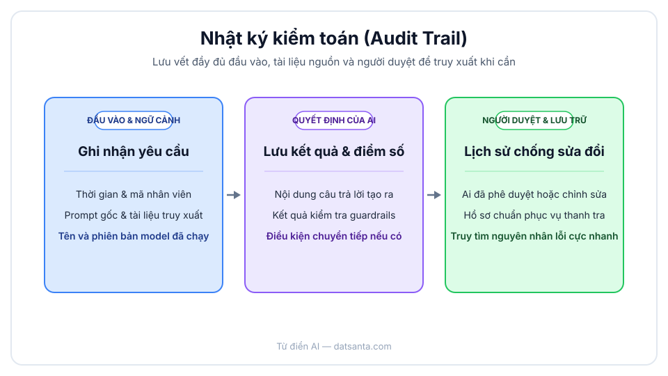

# Audit Trail (Nhật ký kiểm toán)

**Audit trail** là bản ghi tự động, chống chỉnh sửa cho thấy ai đã dùng hệ thống AI, dữ liệu và tài liệu nào đã được đưa vào, AI đã trả lời gì và con người nào đã duyệt hành động cuối cùng.

## Ví dụ thực tế

Tại hiệu thuốc, mỗi đơn thuốc bán ra đều được lưu lại tên bệnh nhân, thời gian, liều lượng và dược sĩ chịu trách nhiệm—để nếu vài tuần sau có sự cố, thanh tra có thể truy vết chính xác điều gì đã xảy ra. Audit trail trong AI hoạt động tương tự: nếu hệ thống duyệt nhầm khoản hoàn tiền hoặc từ chối sai hồ sơ, đội ngũ kỹ thuật có thể mở lại đúng prompt, tài liệu gốc và phiên bản model lúc đó.

## Đừng nhầm với

- **[Post-Deployment Monitoring](post-deployment-monitoring.md):** Monitoring theo dõi chỉ số tốc độ và độ chính xác theo thời gian thực; audit trail lưu giữ hồ sơ lịch sử chi tiết từng ca để phục vụ kiểm toán và điều tra sự cố.

## Thuật ngữ liên quan

- [Compliance](compliance.md)
- [Model Risk Management](model-risk-management.md)
- [Data Governance](data-governance.md)
